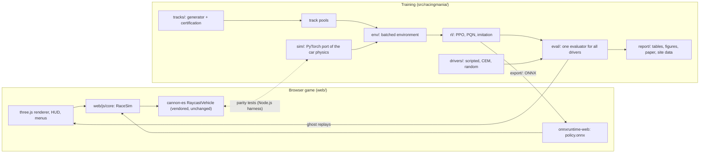

# RacingMania

**An original 3D time-attack racing game for the browser, and reinforcement-learning drivers trained on a tested GPU port of its own car physics.**

**▶ Play it in your browser: <https://burnycoder.github.io/reinforcement-learning-in-trackmania-like-racing-game/>** (results explorer: [results.html](https://burnycoder.github.io/reinforcement-learning-in-trackmania-like-racing-game/results.html))

RacingMania is a small racing game in the time-attack genre popularised by TrackMania: one car, a road with hills, banked turns and jumps floating in the sky, checkpoints, medals, ghosts and instant restarts. It copies none of TrackMania's tracks, art or code. You can play it in the browser with the keyboard and race against AI drivers.

The research question is whether one policy, trained with PPO ([Schulman et al. 2017](https://arxiv.org/abs/1707.06347)) on tens of thousands of procedurally generated tracks, can drive tracks it has never seen, and how it compares with a classical scripted driver and with specialists trained on a single track. The hypotheses, metric and analysis were [preregistered](reports/preregistration.md) before any model was trained.

**How it works, in one paragraph.** The game runs the car physics of [cannon-es](https://github.com/pmndrs/cannon-es) (`RaycastVehicle`, a port of Bullet's raycast vehicle) unchanged in the browser. For training, the same per-tick computation is ported line by line to batched PyTorch, so thousands of cars, each on a different track, run in parallel on one GPU. Tests run the original code in Node.js and require the port to match it: one tick from 6,000 random states agrees to 7e-15 in 64-bit floats. A seeded generator builds tracks from straights, arcs, hills, banking and jumps; a track is kept only if a scripted pure-pursuit driver can finish it, and that driver's time is the reference for the score. The agent sees its own motion and the next 114 m of road in its own frame, presses the same keys a player has (left/none/right × gas/coast/brake, 20 times a second), and is rewarded only for metres of progress along the road.

**Status (2026-11-14): all code is written; the first two models (a specialist on one track and a generalist on many tracks) are next. No result exists yet.** The results section below is generated from result files and fills in as runs finish.

| | |
|---|---|
| Play the game | <https://burnycoder.github.io/reinforcement-learning-in-trackmania-like-racing-game/> (or locally, see [Play](#play)) |
| Results explorer | <https://burnycoder.github.io/reinforcement-learning-in-trackmania-like-racing-game/results.html> |
| Models and results on Hugging Face | [RacingMania RL collection](https://huggingface.co/collections/BurnyCoder/racingmania-rl-6af81116a617ddc332308929), [results dataset](https://huggingface.co/datasets/BurnyCoder/racingmania-results) |
| Plan | [`reports/plan.md`](reports/plan.md) |
| Preregistration | [`reports/preregistration.md`](reports/preregistration.md) |
| Literature review (fact-checked, 286 claims) | [`reports/literature-review.md`](reports/literature-review.md), [`reports/source-ledger.md`](reports/source-ledger.md) |
| Physics specification | [`docs/physics.md`](docs/physics.md) |
| File formats | [`docs/formats.md`](docs/formats.md) |


## What is new here

Prior work trained agents for TrackMania against the real game in real time ([Linesight](https://github.com/Linesight-RL/linesight), [TMRL](https://github.com/trackmania-rl/tmrl)) or for Gran Turismo on PlayStations ([Fuchs et al. 2021](https://arxiv.org/abs/2008.07971), [GT Sophy](https://doi.org/10.1038/s41586-021-04357-7)), almost always one track at a time. Evidence that one policy drives unseen tracks is thin for cars; the closest study is for drones ([Green et al. 2026](https://arxiv.org/abs/2606.27348), a preprint). This project combines, as far as our searches found for the first time: a playable game and a training simulator that share one tested physics implementation; a 3D car with suspension, hills, banking and jumps on keyboard-style actions; a preregistered test on 1,000 unseen tracks with ten seeds, a scripted driver, a blind control and a training-set-size ablation; and systematic reporting of physics exploits the agents find instead of removing them. Details and limits of this claim are in the [literature review, section 14](reports/literature-review.md#14-gaps-and-what-is-new-here).

## Results

<!-- RESULTS:START -->
_Results generated from `results/` by `scripts/07_make_report.py` on 2026-11-14; 17 of 115 planned runs evaluated. Full tables: [`reports/summary.md`](reports/summary.md)._

- The Generalist (PPO) (1 seed) finished 81.5 % of the 971 unseen test tracks (95 % CI 79.0 % to 83.8 %), with a success-weighted speed (SWS) of 1.214 [1.177, 1.250]; an SWS of 1.0 would mean finishing every track as fast as the scripted driver.
- On the tracks it finished, it needed 0.67 times the scripted driver's time (32.7 % less time on average).
- Its finish rate was 81.5 percentage points more than the untrained network (0.0 %, 10 seeds); 81.5 percentage points more than the random actions (0.0 %, 3 seeds).
- The preregistered hypotheses H1-H3 are not tested yet: they need test results from 10 generalist seeds and 5 seeds each of the blind control and the single-track ablation (1 generalist seeds so far).

**Main evaluation table** (SWS = success-weighted speed, 1.0 = as fast as the scripted driver on every track; 95 % two-level bootstrap intervals over seeds and tracks):

| Configuration | Role | Seeds | Test SWS [95 % CI] | Test finished | OOR SWS [95 % CI] | OOR finished | Campaign SWS [95 % CI] | Campaign finished | Val SWS [95 % CI] | Val finished | Train SWS [95 % CI] | Train finished |
|---|---|---|---|---|---|---|---|---|---|---|---|---|
| Scripted driver | Reference | 1 | 0.998 [0.995, 1.000] | 99.8 % | 1.000 [1.000, 1.000] | 100.0 % | 1.000 [1.000, 1.000] | 100.0 % | 1.000 [1.000, 1.000] | 100.0 % | 0.999 [0.997, 1.000] | 99.9 % |
| Random actions | Control | 3 | 0.000 [0.000, 0.000] | 0.0 % | 0.000 [0.000, 0.000] | 0.0 % | 0.000 [0.000, 0.000] | 0.0 % | 0.000 [0.000, 0.000] | 0.0 % | 0.000 [0.000, 0.000] | 0.0 % |
| Untrained network | Control | 10 | 0.000 [0.000, 0.000] | 0.0 % | 0.000 [0.000, 0.000] | 0.0 % | 0.000 [0.000, 0.000] | 0.0 % | 0.000 [0.000, 0.000] | 0.0 % | 0.000 [0.000, 0.000] | 0.0 % |
| Generalist (PPO) [pilot, seed 0] | Main method | 1 | 1.199 [1.160, 1.237] | 80.2 % | 0.788 [0.678, 0.899] | 52.4 % | 1.596 [1.447, 1.799] | 100.0 % | 1.242 [1.159, 1.319] | 82.7 % | 1.234 [1.198, 1.269] | 82.6 % |
| Generalist (PPO) | Main method | 1 | 1.214 [1.177, 1.250] | 81.5 % | 0.875 [0.769, 0.982] | 57.8 % | 1.590 [1.451, 1.783] | 100.0 % | 1.236 [1.153, 1.315] | 82.7 % | 1.250 [1.214, 1.283] | 83.9 % |
| Specialist (campaign-01) [pilot, seed 0] | Specialist | 1 | — | — | — | — | 0.306 [0.000, 0.918] | 20.0 % | 0.188 [0.123, 0.260] | 13.2 % | — | — |

**Preregistered hypotheses:**

|  | Hypothesis | Tested quantity | Seeds (have/required) | Estimate [95 % CI] | Test statistic | p (one-sided) | p (Holm) | Decision |
|---|---|---|---|---|---|---|---|---|
| H1 | The generalist drives unseen tracks better than the scripted driver | SWS > 1.0 | generalist 1/10 | 1.214 [1.177, 1.250] (preliminary) | — | — | — | **not yet tested** |
| H2 | Track diversity is what generalises (50,000 tracks vs 1 track) | SWS difference > 0.1 | generalist 1/10, size-1 0/5 | — | — | — | — | **not yet tested** |
| H3 | The agent uses the look-ahead (generalist vs blind control) | SWS difference > 0.1 | generalist 1/10, blind 0/5 | — | — | — | — | **not yet tested** |


<!-- RESULTS:END -->

## Method

### The game and its physics

- **Car.** A chassis box (500 kg, 4.7 × 1.1 × 2.0 m) on four spring-damper suspension rays; tyre forces are cannon-es's side-friction and rolling-friction impulses limited by a friction circle. The engine force fades to zero at the top speed (45 m/s), braking is an impulse per tick, and steering is rate-limited and loses authority with speed. All numbers live in [`web/assets/vehicle.json`](web/assets/vehicle.json), read by both the game and the port.
- **Tick.** 100 physics ticks per second; one action is held for 5 ticks. One tick is gravity → velocity damping → `RaycastVehicle.updateVehicle` → semi-implicit Euler integration, exactly as in cannon-es ([`docs/physics.md`](docs/physics.md)).
- **Rules.** Checkpoints in order; a run is *out* when the car falls 3 m below the road, stays airborne for 5 s, or makes no 0.5 m of progress in 2 s. Players respawn at the last checkpoint with the clock running; for the agent an out ends the episode.
- **Known quirks** of cannon-es (unlimited straight-line braking grip, no rolling resistance, one ray per wheel) are left in on purpose and reported if agents exploit them, the way TrackMania players use "uberbugs" ([TAS Exchange FAQ](https://tmtas.exchange/faq)) and OpenAI's hide-and-seek agents learned box surfing ([Baker et al. 2020](https://arxiv.org/abs/1909.07528)).

### Tracks

A track is a ribbon in the sense of [Perantoni & Limebeer 2015](https://doi.org/10.1115/1.4028253): a centreline sampled every 2 m, a banked left vector per sample, a 12 m wide road, gaps for jumps and checkpoints. Plans follow the [TORCS track format](https://torcs.sourceforge.net/api/track_manual.html): straights and arcs with height changes and banking, plus parabolic-kicker jumps on long straights. Generated tracks are identified by seeds in disjoint ranges:

| Set | Seeds | Use |
|---|---|---|
| Training pool | 0–49,999 | training only |
| Validation | 1,000,000–1,000,199 | every development decision |
| Test | 2,000,000–2,000,999 | reported scores only; each read is logged |
| Out-of-range test | 3,000,000–3,000,199 | one factor beyond the training range |
| Campaign | 5 hand-made | the game and the specialist experiment |

A candidate track enters a set only if the scripted driver finishes it at 0.9, 1.0 and 1.1 × its target speeds; the time at 1.0 is the track's reference time.

### Agent

PPO adapted from CleanRL's GPU script ([CleanRL](https://github.com/vwxyzjn/cleanrl), [Huang et al. 2022](https://iclr-blog-track.github.io/2022/03/25/ppo-implementation-details/)), with separate 2 × 256 tanh actor and critic networks, two 3-way categorical action heads, observation normalisation, bootstrapping on time limits ([Rudin et al. 2021](https://arxiv.org/abs/2109.11978)), a KL-adaptive learning rate, 16,384 parallel cars and 32-step rollouts. Episodes start at the official start or at random points along the track ([Song et al. 2021](https://arxiv.org/abs/2103.08624)). The observation (160 numbers) is the car's velocity, spin, attitude, steering angle, wheel contacts, previous action, and 20 upcoming centreline points with their left vectors and gap flags, all in the car's frame.

### Evaluation

The primary metric is the **success-weighted speed** on the 1,000 test tracks: per track, (reference time ÷ agent time) if the agent finishes within 3 × the reference time, else 0, averaged over tracks. It adapts SPL ([Anderson et al. 2018](https://arxiv.org/abs/1807.06757)) from path length to time. Baselines: random actions, an untrained network, the scripted driver (1.0 by construction) and a CEM planner as a near-optimal reference. Controls: a blind agent without the look-ahead and agents trained on 1–10,000 tracks. Hypotheses and tests are in the [preregistration](reports/preregistration.md).

## Architecture



### What happens when you run the pipeline

1. `01_generate_tracks.py` tunes the scripted driver on validation candidates, generates every set in parallel, drives each candidate to certify it, and saves the sets as pools (large files under `RACINGMANIA_DATA_DIR`) with summaries in `results/tracks/`.
2. `02_train.py` trains one run on the GPU, logging to the terminal, a timestamped log file, `results/<run>/train_metrics.csv` and TensorBoard, evaluating on validation tracks every 10 minutes and checkpointing every 10 minutes (it resumes automatically after a crash or reboot).
3. `03_evaluate.py` scores the final checkpoint on the chosen sets with the common evaluator and writes per-track CSVs; reading the test sets is logged.
4. `04_baselines.py` scores the training-free baselines the same way.
5. `06_export_web.py` exports the policy to ONNX (checked against PyTorch), copies the AI's runs as ghosts, and registers both in the game.
6. `07_make_report.py` regenerates every table, figure, report, the paper, this README's results block and the results website from the result files.
7. `05_run_matrix.py` runs all of the above for every run of the [run matrix](configs/run_matrix.yaml), publishing to GitHub and Hugging Face before training, after training and after evaluation.

## Install

Requirements: Windows 11 or Linux, an NVIDIA GPU with a recent driver (training used an RTX 5070 Laptop GPU, 8 GB), [uv](https://docs.astral.sh/uv/), Node.js ≥ 20 (for the parity tests), and optionally WSL2 on Windows (training there is about 10× faster because `torch.compile` works).

```bash
git clone https://github.com/BurnyCoder/reinforcement-learning-in-trackmania-like-racing-game.git
```

```bash
cd reinforcement-learning-in-trackmania-like-racing-game
```

```bash
uv sync
```

```bash
npm install
```

Copy `.env.example` to `.env` and set `RACINGMANIA_DATA_DIR` to a folder with ~20 GB free. PyTorch is installed from the CUDA 13.2 wheel index configured in `pyproject.toml`.

In WSL2, keep the Linux virtual environment on the Linux file system:

```bash
export UV_PROJECT_ENVIRONMENT=$HOME/venvs/racingmania && uv sync
```

## Play

Online: <https://burnycoder.github.io/reinforcement-learning-in-trackmania-like-racing-game/> (deployed from `web/` by `.github/workflows/pages.yml` on every push to `main`). Locally:

```bash
uv run python -m http.server 8123 --directory web
```

Then open <http://localhost:8123/>. Arrows or WASD drive (up = gas, down = brake/reverse), Enter or R restarts, Backspace respawns at the last checkpoint, Esc returns to the menu.

## Reproduce

```bash
uv run pytest tests/unit tests/parity -q
```

```bash
uv run python scripts/bench_sim.py --compile
```

```bash
uv run python scripts/01_generate_tracks.py
```

```bash
uv run python scripts/04_baselines.py --sets val campaign test oor --cem
```

```bash
uv run python scripts/05_run_matrix.py
```

```bash
uv run python scripts/07_make_report.py
```

Single runs: `uv run python scripts/02_train.py --experiment generalist --seed 1`, then `uv run python scripts/03_evaluate.py --experiment generalist --seed 1 --sets val train_sample campaign test oor`. Live dashboard during training: `uv run tensorboard --logdir <RACINGMANIA_DATA_DIR>/tensorboard`.

Diagnostics: `scripts/09_failure_analysis.py --run generalist/seed0 --sets val` writes where a run's failures happen (sharpest turn and jumps in the 60 m before each fall, against random places) to `results/<run>/failures_<set>.json`; `scripts/10_diagnose_flag.py --experiment generalist --seed 0 --set train_sample --track train-198` replays an exploit-flagged track step by step with its translational, gravitational and rotational energy; `scripts/tune_cem.py 30 60 90` compares CEM planning horizons on validation tracks.

## Features

- Playable browser game: five campaign tracks, medals, splits, your best ghost, AI ghosts, race against a live AI driver.
- One physics implementation for game and training, with tick-by-tick parity tests against the original.
- GPU simulator: about 640,000 agent steps per second with `torch.compile` in WSL2 (16,384 cars, RTX 5070 Laptop).
- Seeded track generator with certification by driving and disjoint train/validation/test seed ranges.
- PPO, PQN, behaviour cloning, DAgger and hybrid variants; scripted, random, untrained and CEM baselines.
- Resumable training, timestamped logs, TensorBoard dashboard, one-command reports and paper.

## Technologies

Python 3.13, PyTorch 2.15 (CUDA 13.2), `torch.compile`/Triton, NumPy, SciPy, Matplotlib, TensorBoard, ONNX and onnxruntime, Hugging Face Hub; JavaScript ES modules, three.js r187, cannon-es 0.20.0, onnxruntime-web 1.31.1; Node.js for the parity harness; Playwright for browser tests; uv; pandoc and typst for the paper.

## Licence

MIT for this project's code (see `LICENSE`). Third-party code and its licences are listed in [`THIRD_PARTY_NOTICES.md`](THIRD_PARTY_NOTICES.md).
