# RacingMania

**An original 3D time-attack racing game for the browser, and reinforcement-learning drivers trained on a tested GPU port of its own car physics.**

**▶ Play it in your browser: <https://burnycoder.github.io/reinforcement-learning-in-trackmania-like-racing-game/>** (results explorer: [results.html](https://burnycoder.github.io/reinforcement-learning-in-trackmania-like-racing-game/results.html))

RacingMania is a small racing game in the time-attack genre popularised by TrackMania: one car, a road with hills, banked turns and jumps floating in the sky, checkpoints, medals, ghosts and instant restarts. It copies none of TrackMania's tracks, art or code. You can play it in the browser with the keyboard and race against AI drivers.

**Learned by reinforcement learning alone.** The trained AI drivers below learned with PPO from a reward for metres of progress along the road and nothing else: no human or scripted demonstrations, no imitation learning, no reward terms or start states taken from the scripted driver, and no hand-written driving rules in the policy, which is a small neural network (2 × 256 units) that picks keys from what it observes. The scripted driver is used only to check that a generated track can be finished and as the yardstick for the score. The agent does observe the road ahead as exact track data from the game, not as pixels. Imitation and hybrids with the scripted driver are a separate, later phase (phase 4) that has not run yet. Each run's settings are recorded in `results/<run>/run.json` (reward scale 0.1 per metre, hint weight 0, no scripted starts, no imitation warm start).

<!-- VIDEOS:START -->
## Videos

Each clip replays an official evaluation run in the browser game: the car states the evaluator recorded while scoring the run, shown by the game's renderer ("Watch replay"). Each clip is chosen by a fixed rule from the official evaluation and labelled with its result; click a clip for the full-resolution MP4. In the game the trained policies also drive live ("Watch AI", "Race vs AI"), where the browser's 64-bit physics can make a long lap differ slightly from the official 32-bit GPU run. Generated by `scripts/11_record_videos.py` from `docs/videos/clips.yaml` and `results/<run>/eval_*.csv`.

### Positive results

#### 1. Best specialist lap

[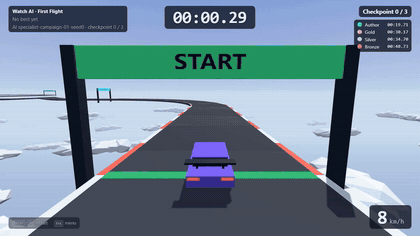](docs/videos/specialist-campaign-01-seed0_campaign-01.mp4)

- **What you see:** The specialist has driven only this one track during training, so it knows every corner. Watch it accelerate hard from the start, hold high speed on the straights, keep its speed through the bends by staying close to the edge, and take the jump without slowing down. It is the fastest of all drivers evaluated so far on this track, but what it learned is how to drive this one track: on tracks with a different layout it mostly falls off (see the results).
- **Model:** `specialist-campaign-01/seed0`: PPO, trained by reinforcement learning for 200 million agent steps on campaign-01 only (seed 0, 0.3 h on one GPU).
- **Map:** First Flight (`campaign-01`), a hand-made campaign track, 628 m long with 1 jump and up to 6° of banking; the track this model was trained on.
- **Evaluation:** official evaluation in `results/specialist-campaign-01/seed0/eval_campaign.csv` (standing start, most probable action, final checkpoint): finished in 19.71 s; the scripted driver needs 30.17 s, so this is 1.53× its speed. The clip replays this run.
- **Why this clip:** chosen by a fixed rule as its only finished campaign track in its official evaluation.

#### 2. Best generalist lap on a hand-made track it never saw in training: it generalized

[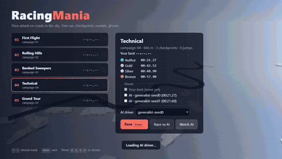](docs/videos/generalist-seed0_campaign-04.mp4)

- **What you see:** This is generalization: driving well on a track the model never saw in training. The generalist learned on tens of thousands of generated tracks and never on these hand-made ones, which were designed separately. It reads the road ahead, picks a speed for each bend, and laps this track in about half the scripted driver's time. On the specialist's own track it is only slightly slower than the specialist (see the results). Compare clip 7 among the negative results: the specialist on this same track.
- **Model:** `generalist/seed0`: PPO, trained by reinforcement learning for 1 billion agent steps on 48,949 generated training tracks (seed 0, 1.3 h on one GPU).
- **Map:** Technical (`campaign-04`), a hand-made campaign track, 666 m long with no jumps and up to 5° of banking; this model never saw it during training.
- **Evaluation:** official evaluation in `results/generalist/seed0/eval_campaign.csv` (standing start, most probable action, final checkpoint): finished in 21.27 s; the scripted driver needs 42.52 s, so this is 2.00× its speed. The clip replays this run.
- **Why this clip:** chosen by a fixed rule as the highest-scoring finished track of the 5 campaign tracks it finished in its official evaluation.

#### 3. Best generalist lap on a held-out generated track it never saw in training: it generalized

[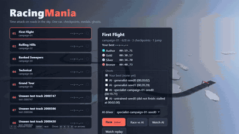](docs/videos/generalist-seed0_test-2000747.mp4)

- **What you see:** Generalization again, now on a generated track from the held-out test seeds: the same kind of track as in training, but never this one, driven from the standing start to the finish. Watch it slow down for each bend, hug the inside edge through it and accelerate out again, using only what it sees of the road ahead. Compare it with the next clip, the scripted driver on the same track.
- **Model:** `generalist/seed0`: PPO, trained by reinforcement learning for 1 billion agent steps on 48,949 generated training tracks (seed 0, 1.3 h on one GPU).
- **Map:** Unseen test track 2000747 (`test-2000747`), a held-out generated test track, 1,461 m long with no jumps and up to 11° of banking; this model never saw it during training.
- **Evaluation:** official evaluation in `results/generalist/seed0/eval_test.csv` (standing start, most probable action, final checkpoint): finished in 43.35 s; the scripted driver needs 79.77 s, so this is 1.84× its speed. The clip replays this run.
- **Why this clip:** chosen by a fixed rule as the highest-scoring finished track of the 779 test tracks it finished in its official evaluation.

#### 4. Scripted driver on the same held-out track, for comparison

[](docs/videos/scripted-driver_test-2000747.mp4)

- **What you see:** The same track as the clip before, driven by the hand-written scripted driver. It drives the track cleanly, but it is cautious: in the bends it slows to well under half the generalist's speed, and it never reaches the speeds the generalist holds on the straights, so it needs almost twice as long (speeds measured from both recorded runs). Its time on each track is the yardstick of the score: 1.0 means as fast as this driver.
- **Model:** `baselines/scripted/seed0`: the scripted driver, a hand-written controller (pure-pursuit steering and a curvature-based speed profile, see [The scripted driver](#the-scripted-driver)) with its 2 parameters tuned on validation tracks before any training (a_lat = 6.0 m/s², look-ahead gain = 0.3 s); nothing is learned, and its time on each track is the reference that scores 1.0.
- **Map:** Unseen test track 2000747 (`test-2000747`), a held-out generated test track, 1,461 m long with no jumps and up to 11° of banking; the scripted driver is not trained; it drove this track once before, to certify it and set its reference time.
- **Evaluation:** official evaluation in `results/baselines/scripted/seed0/eval_test.csv` (standing start, most probable action, final checkpoint): finished in 79.75 s (the track's reference time, from the scripted driver's separate certification run, is 79.77 s). The clip replays this run.
- **Why this clip:** chosen by a fixed rule as the same track as the generalist/seed0 clip: the highest-scoring finished track of the 779 test tracks `generalist/seed0` finished in its official evaluation.

#### 5. Typical generalist lap on a held-out generated track it never saw in training

[](docs/videos/generalist-seed0_test-2000386.mp4)

- **What you see:** Not the best lap but a typical one: the median of the generalist's finished test tracks that have a jump. It shows what most of its successful laps on unseen tracks look like: a clean run with a jump, clearly faster than the scripted driver but less spectacular than the best lap.
- **Model:** `generalist/seed0`: PPO, trained by reinforcement learning for 1 billion agent steps on 48,949 generated training tracks (seed 0, 1.3 h on one GPU).
- **Map:** Unseen test track 2000386 (`test-2000386`), a held-out generated test track, 1,097 m long with 1 jump and up to 10° of banking; this model never saw it during training.
- **Evaluation:** official evaluation in `results/generalist/seed0/eval_test.csv` (standing start, most probable action, final checkpoint): finished in 33.01 s; the scripted driver needs 49.36 s, so this is 1.50× its speed. The clip replays this run.
- **Why this clip:** chosen by a fixed rule as the median-scoring finished track among those with at least one jump (397 test tracks with a jump that it finished) in its official evaluation.

#### 6. Seed 1's specialist finishes a held-out track it never trained on: it generalized

[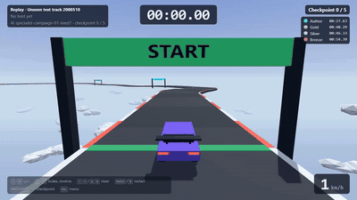](docs/videos/specialist-campaign-01-seed1_test-2000510.mp4)

- **What you see:** This is generalization too, by a specialist: driving well on a track it never saw in training. It is a second specialist, trained the same way on campaign track 1 only but with seed 1. It finishes about one unseen test track in five, and this is a typical one of them (median score). Its finishes lean towards easier tracks like this one: shorter, less banked and with fewer jumps than average. Where its driving carries over it is fast: on the tracks both finish it is as fast as the generalist, slightly faster on most of them, and on this track the two times are almost equal (see the evaluation line). But the generalist also finishes almost all of the tracks the specialist finishes, plus many harder ones the specialist falls off: about four unseen test tracks in five. That is the difference between learning one track and learning many.
- **Model:** `specialist-campaign-01/seed1`: PPO, trained by reinforcement learning for 200 million agent steps on campaign-01 only (seed 1, 0.2 h on one GPU).
- **Map:** Unseen test track 2000510 (`test-2000510`), a held-out generated test track, 934 m long with no jumps and up to 3° of banking; this model never saw it during training.
- **Evaluation:** official evaluation in `results/specialist-campaign-01/seed1/eval_test.csv` (standing start, most probable action, final checkpoint): finished in 27.63 s; the scripted driver needs 40.29 s, so this is 1.46× its speed; on the same track `generalist/seed0` finished in 27.61 s. The clip replays this run.
- **Why this clip:** chosen by a fixed rule as the median-scoring finished track of the 192 test tracks it finished in its official evaluation.

### Negative results

#### 7. The specialist does not generalize: clip 1's model on clip 2's track, which it never trained on

[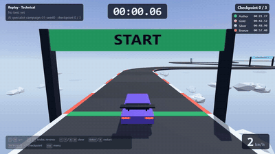](docs/videos/specialist-campaign-01-seed0_campaign-04.mp4)

- **What you see:** The specialist from clip 1, on the track of clip 2, which it never trained on. For the first seconds it accelerates exactly like the generalist, but then it brakes to a crawl, drifts towards the edge of a bend and drops off the road, while the generalist on the same track keeps accelerating (clip 2; speeds compared from both recorded runs). Trained on one track, it learned to drive that track, and that driving does not carry over to a different layout, which is why the README's results show it finishing so few unseen tracks.
- **Model:** `specialist-campaign-01/seed0`: PPO, trained by reinforcement learning for 200 million agent steps on campaign-01 only (seed 0, 0.3 h on one GPU).
- **Map:** Technical (`campaign-04`), a hand-made campaign track, 666 m long with no jumps and up to 5° of banking; this model never saw it during training.
- **Evaluation:** official evaluation in `results/specialist-campaign-01/seed0/eval_campaign.csv` (standing start, most probable action, final checkpoint): did not finish: fell after 7.44 s and 73 m (the scripted driver finishes in 42.52 s). The clip replays this run.
- **Why this clip:** chosen by a fixed rule as the same track as the generalist/seed0 clip: the highest-scoring finished track of the 5 campaign tracks `generalist/seed0` finished in its official evaluation.

#### 8. Generalization failure on a held-out track: the generalist falls off halfway round

[](docs/videos/generalist-seed0_test-2000430.mp4)

- **What you see:** Generalization does not always work. About one unseen track in five ends like this: the generalist enters a bend too fast, cannot hold the line and leaves the road on the outside. Most of its falls come right after tight corners rather than at jumps (failure analysis in `results/generalist/seed*/failures_*.json`): it trades safety for speed.
- **Model:** `generalist/seed0`: PPO, trained by reinforcement learning for 1 billion agent steps on 48,949 generated training tracks (seed 0, 1.3 h on one GPU).
- **Map:** Unseen test track 2000430 (`test-2000430`), a held-out generated test track, 1,559 m long with no jumps and up to 14° of banking; this model never saw it during training.
- **Evaluation:** official evaluation in `results/generalist/seed0/eval_test.csv` (standing start, most probable action, final checkpoint): did not finish: fell after 24.43 s and 776 m (the scripted driver finishes in 66.30 s). The clip replays this run.
- **Why this clip:** chosen by a fixed rule as the fall whose position is closest to the middle of its track among its 190 falls on test tracks in its official evaluation.

#### 9. Generalization failure beyond the training range: a corner tighter than any training track

[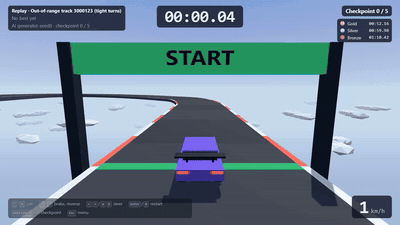](docs/videos/generalist-seed0_oor-3000123.mp4)

- **What you see:** This track was generated with tighter corners than any track the generalist trained on. It approaches the corner at a speed that would suit the wider corners it knows and flies off the outside. Learning from many tracks lets it drive new combinations of familiar features, but not features outside what it has seen: on tracks like this it almost always falls, while longer jumps than in training, for example, are handled well (see the results).
- **Model:** `generalist/seed0`: PPO, trained by reinforcement learning for 1 billion agent steps on 48,949 generated training tracks (seed 0, 1.3 h on one GPU).
- **Map:** Out-of-range track 3000123 (`oor-3000123`), a held-out out-of-range test track with one factor beyond the training range, arc radius 14–22 m (training: 22–120 m), 855 m long with 2 jumps and up to 9° of banking; this model never saw it during training.
- **Evaluation:** official evaluation in `results/generalist/seed0/eval_oor.csv` (standing start, most probable action, final checkpoint): did not finish: fell after 17.76 s and 449 m (the scripted driver finishes in 52.16 s). The clip replays this run.
- **Why this clip:** chosen by a fixed rule as the fall whose position is closest to the middle of its track among its 43 falls on tight-turn out-of-range tracks in its official evaluation.

### Controls

#### 10. Untrained network (control) on the specialist's track

[](docs/videos/untrained-seed0_campaign-01.mp4)

- **What you see:** Like every evaluated driver, the network takes its most probable action at each step instead of sampling one. With random initial weights its output layer starts close to zero (standard deviation 0.01, the CleanRL convention), so it picks almost the same keys every step, here steering right while coasting, and never presses gas. Sampled instead of taken greedily, the same network would press keys almost uniformly at random, which is how PPO starts exploring.
- **Model:** `baselines/untrained/seed0`: the same network as the trained agents (2 × 256 units) with random initial weights (seed 0) and no training; a control.
- **Map:** First Flight (`campaign-01`), a hand-made campaign track, 628 m long with 1 jump and up to 6° of banking; this network was never trained on any track.
- **Evaluation:** official evaluation in `results/baselines/untrained/seed0/eval_campaign.csv` (standing start, most probable action, final checkpoint): did not finish: stalled after 2.00 s and 6 m (the scripted driver finishes in 30.17 s). The clip replays this run.

#### 11. Untrained network with sampled actions: almost uniformly random keys, as PPO starts exploring

[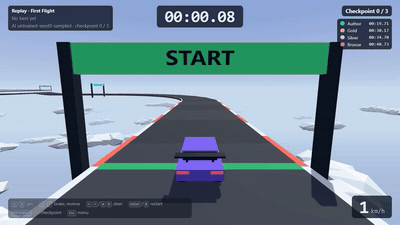](docs/videos/untrained-seed0-sampled_campaign-01.mp4)

- **What you see:** The same network and weights as the clip before. The official evaluation takes the most probable action; here the keys of every step are drawn from the network's own probabilities, which are close to one in three for each steering and each pedal choice, so they are almost uniformly random, as at the start of PPO training. The car jitters between gas, coast and brake and drifts a few dozen metres before it is out for lack of progress. This is a demonstration run, not part of the scored evaluation.
- **Model:** `demos/untrained-sampled/seed0`: the untrained control network (random initial weights, seed 0) with each action sampled from its probabilities (sampling seed 1000) instead of the most probable one.
- **Map:** First Flight (`campaign-01`), a hand-made campaign track, 628 m long with 1 jump and up to 6° of banking; this network was never trained on any track.
- **Evaluation:** demonstration run through the same evaluator, recorded in `results/demos/untrained-sampled/seed0/eval_campaign.csv` (standing start, sampled actions; not scored): did not finish: stalled after 28.99 s and 52 m (the scripted driver finishes in 30.17 s). The clip replays this run.
- **Over many runs:** in 200 runs each on this track, random actions are out after 9.4 s on average (median 6.1 s, 10–90 % range 2.0–21.0 s) and the untrained network with sampled actions after 9.8 s (median 6.5 s, 2.0–23.1 s), with no detectable difference between them (Mann–Whitney p = 0.50 for the time, 0.48 for the progress). The gap between the two random clips is therefore consistent with luck, and this run is a lucky one, above the 90th percentile of its runs (`results/demos/random-vs-sampled/campaign-01.json`, `scripts/14_random_vs_sampled.py`).

#### 12. Random actions (control) on the specialist's track

[](docs/videos/random-seed0_campaign-01.mp4)

- **What you see:** This control presses a uniformly random key combination every agent step (0.05 s). Gas, coast and brake, which reverses at a standstill, each come up a third of the time and cancel out, so the car makes almost no progress and is out under the "no 0.5 m of progress in 2 s" rule.
- **Model:** `baselines/random/seed0`: random actions, a uniformly random key combination every agent step from a seeded generator (seed 0); no network and no training; a control.
- **Map:** First Flight (`campaign-01`), a hand-made campaign track, 628 m long with 1 jump and up to 6° of banking; random actions ignore the track entirely.
- **Evaluation:** official evaluation in `results/baselines/random/seed0/eval_campaign.csv` (standing start, most probable action, final checkpoint): did not finish: stalled after 2.00 s and 6 m (the scripted driver finishes in 30.17 s). The clip replays this run.
- **Over many runs:** in 200 runs each on this track, random actions are out after 9.4 s on average (median 6.1 s, 10–90 % range 2.0–21.0 s) and the untrained network with sampled actions after 9.8 s (median 6.5 s, 2.0–23.1 s), with no detectable difference between them (Mann–Whitney p = 0.50 for the time, 0.48 for the progress). The gap between the two random clips is therefore consistent with luck, and this run is an unlucky one: 27% of its runs end at 2.0 s like this one (`results/demos/random-vs-sampled/campaign-01.json`, `scripts/14_random_vs_sampled.py`).
<!-- VIDEOS:END -->

The research question is whether one policy, trained with PPO ([Schulman et al. 2017](https://arxiv.org/abs/1707.06347)) on tens of thousands of procedurally generated tracks, can drive tracks it has never seen, and how it compares with a classical scripted driver and with specialists trained on a single track. The hypotheses, metric and analysis were [preregistered](reports/preregistration.md) before any model was trained.

**How it works, in one paragraph.** The game runs the car physics of [cannon-es](https://github.com/pmndrs/cannon-es) (`RaycastVehicle`, whose code follows Bullet's `btRaycastVehicle`) unchanged in the browser. For training, the same per-tick computation is ported line by line to batched PyTorch, so thousands of cars, each on a different track, run in parallel on one GPU. Tests run the original code in Node.js and require the port to match it: one tick from 6,000 random states agrees to 7e-15 in 64-bit floats. A seeded generator builds tracks from straights, arcs, hills, banking and jumps; a track is kept only if a scripted pure-pursuit driver can finish it, and that driver's time is the reference for the score. The agent sees its own motion and the next 114 m of road in its own frame, presses the same keys a player has (left/none/right × gas/coast/brake, 20 times a second), and is rewarded only for metres of progress along the road. Its policy is a small neural network (two hidden layers of 256 tanh units) trained with PPO; the network, reward and training settings are spelled out in [Agent](#agent-network-architecture-reward-and-ppo-settings).


**Status (2026-11-14): training is paused; the remaining runs are postponed to a later date.** Phase 1 is done: both first models (a specialist on one track and a generalist on the generated training pool) learned with the preregistered starting recipe and passed their learning gates, so the recipe was frozen unchanged. Phase 2 (one seed of every experiment) is partly done: the generalist, blind control, PQN, the five specialists, the five specialists fine-tuned from the generalist and the single-track ablation are evaluated; the other training-set sizes and the input, action and reward ablations are not. Phase 3 has no runs, because no agent used a physics exploit. Phases 4 (imitation and hybrids), 5 (hyperparameter sensitivity) and 6 (seed sensitivity, where H1-H3 are formally tested) have not started. The [results](#results) section and the chart below are generated from the result files; every number in them is from one or two seeds and is preliminary. How to resume: [Reproduce](#reproduce).

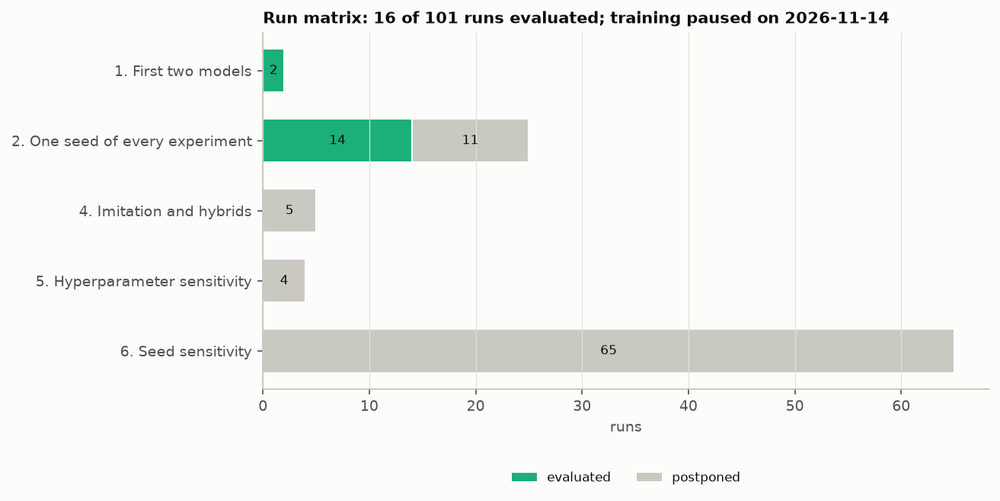

**Findings so far (preliminary, one or two seeds):**
- Hypotheses, read preliminarily from one seed per configuration (not the preregistered tests): H1 (beats the scripted driver on unseen tracks), H2 (track diversity is what generalises) and H3 (uses the look-ahead) all point the predicted way, with intervals clear of their thresholds. These intervals reflect only which test tracks were sampled, not seed-to-seed variation. Seed sensitivity, hyperparameter sensitivity, imitation and hybrids, and the rest of phase 2 are not done. Numbers: [Results](#results).
- Trained on a single generated track instead of the whole pool, the same recipe drives that one track fast but finishes only about a third of the unseen test tracks, against about four in five for the generalist (one seed each).
- Specialists fine-tuned from the generalist on one campaign track become specialists: they finish far fewer unseen test tracks than the generalist they started from (one seed per track).
- The generalist finishes most held-out test tracks it never saw and, on the tracks it finishes, is clearly faster than the scripted driver; its scores on unseen tracks and on its own training tracks are about the same. It also finishes all five hand-made campaign tracks, which were never used in training, about as fast as the specialist trained on one of them.
- Its failures are falls off the road, mostly right after tight corners, not at jumps ([`scripts/09_failure_analysis.py`](scripts/09_failure_analysis.py), `results/generalist/seed*/failures_*.json`). On out-of-range tracks with tighter turns than any in training it almost always falls, while longer jumps than in training transfer well.
- The specialist does not transfer: off its own track it mostly falls.
- No agent has exploited a physics quirk so far. Every exploit flag so far came from a run that crashed and failed; the replays fit a cannon-es suspension quirk that adds a little energy when a wheel touches a surface at a steep angle ([`docs/physics.md`](docs/physics.md)). One earlier false alarm led to a better energy detector that also counts rotation.
- A CEM planner (model-predictive control in the simulator) finishes nearly every track it was run on, but the trained generalist is faster wherever both finish, so CEM is reported as a planning reference, not as an upper bound.
- Measurement lessons, each recorded as a dated amendment: official evaluations now compile the simulator afresh for each set (float32 rounding had made scores depend on evaluation order), and a few percent of tracks are decided by such rounding noise. Details: [`reports/notes/first-models.md`](reports/notes/first-models.md).

| | |
|---|---|
| Play the game | <https://burnycoder.github.io/reinforcement-learning-in-trackmania-like-racing-game/> (or locally, see [Play](#play)) |
| Results explorer | <https://burnycoder.github.io/reinforcement-learning-in-trackmania-like-racing-game/results.html> |
| Models and results on Hugging Face | [RacingMania RL collection](https://huggingface.co/collections/BurnyCoder/racingmania-rl-6af81116a617ddc332308929), [results dataset](https://huggingface.co/datasets/BurnyCoder/racingmania-results); each model card plays videos of that model's official evaluation runs |
| Plan | [`reports/plan.md`](reports/plan.md) |
| Notes for contributors and coding agents | [`AGENTS.md`](AGENTS.md) |
| Preregistration | [`reports/preregistration.md`](reports/preregistration.md) |
| Literature review (fact-checked, 286 claims) | [`reports/literature-review.md`](reports/literature-review.md), [`reports/source-ledger.md`](reports/source-ledger.md) |
| Physics specification | [`docs/physics.md`](docs/physics.md) |
| File formats | [`docs/formats.md`](docs/formats.md) |

**Track menu.** Pick a track on the left (five hand-made campaign tracks, then held-out tracks no agent trained on). The track's panel shows your best time, the medal targets and the AI drivers table: every network and recorded official run, best time on this track first, with its medal, whether it was trained on this track, and a ghost toggle. The chosen driver is the one you race (Race vs AI), watch live (Watch AI) or replay (Watch replay).

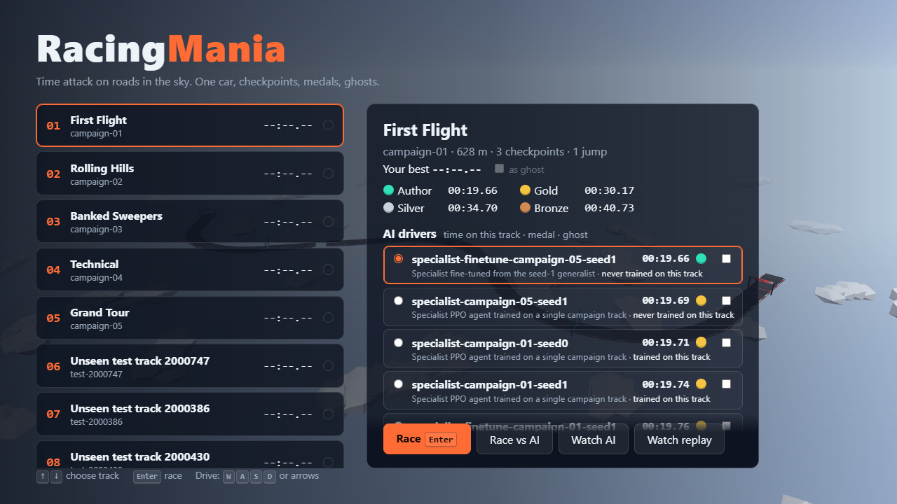

**Racing.** The chase camera on campaign track 1, with the timer, checkpoint count, speed, and the ghost of your best run (the grey car) ahead.

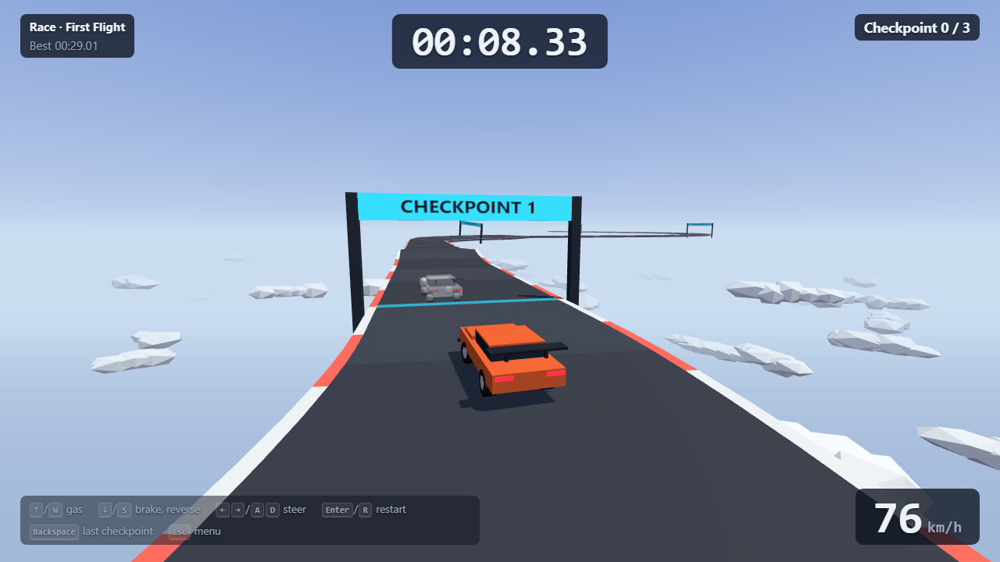

## What is new here

Prior work trained agents for TrackMania against the real game, sped up through TMInterface ([Linesight](https://github.com/Linesight-RL/linesight)) or in real time ([TMRL](https://github.com/trackmania-rl/tmrl)), or for Gran Turismo on PlayStations ([Fuchs et al. 2021](https://arxiv.org/abs/2008.07971), [GT Sophy](https://doi.org/10.1038/s41586-021-04357-7)), on one or a handful of tracks. Evidence that one policy drives unseen tracks is thin for cars; the closest study is for drones ([Green et al. 2026](https://arxiv.org/abs/2606.27348), a preprint). This project combines, as far as our searches found for the first time: a playable game and a training simulator that share one tested physics implementation; a 3D car with suspension, hills, banking and jumps on keyboard-style actions; a preregistered test on 1,000 held-out test seeds (scored on the tracks the scripted driver certifies) with ten seeds, a scripted driver, a blind control and a training-set-size ablation; and systematic reporting of physics exploits the agents find instead of removing them. Details and limits of this claim are in the [literature review, section 14](reports/literature-review.md#14-gaps-and-what-is-new-here).

## Results

<!-- RESULTS:START -->
_Results generated from `results/` by `scripts/07_make_report.py` on 2026-11-14; 30 of 116 planned runs evaluated. Full tables: [`reports/summary.md`](reports/summary.md)._

- The Generalist (PPO) (1 seed) finished 81.5 % of the 971 unseen test tracks (95 % CI 79.0 % to 83.8 %), with a success-weighted speed (SWS) of 1.214 [1.177, 1.250]; an SWS of 1.0 would mean finishing every track as fast as the scripted driver.
- On the tracks it finished, it needed 0.67 times the scripted driver's time (32.7 % less time on average).
- Its finish rate was 8.1 percentage points more than the blind control (73.3 %, 1 seed); 1.6 percentage points more than the PQN (79.8 %, 1 seed); 81.5 percentage points more than the untrained network (0.0 %, 10 seeds); 81.5 percentage points more than the random actions (0.0 %, 3 seeds).
- The preregistered tests of H1-H3 are not done yet: they need test results from 10 generalist seeds and 5 seeds each of the blind control and the single-track ablation (so far: generalist 1, single-track ablation (N = 1) 0, blind control 1). Preliminary readings from the seeds available, not tests:
- H1: The generalist drives unseen tracks better than the scripted driver. SWS 1.214 [1.177, 1.250]; preliminary (1 seed, track resampling only): the interval lies above 1.0, consistent with H1.
- H2: Track diversity is what generalises (50,000 tracks vs 1 track). Not estimable yet: the single-track ablation (N = 1) has no test results yet.
- H3: The agent uses the look-ahead (generalist vs blind control). SWS difference, paired on the same tracks, 0.204 [0.164, 0.245]; preliminary (1 seed per group, track resampling only): the interval lies above 0.1, consistent with H3.
- Exploratory and not H2 itself: specialists trained on one hand-made track each finished 5.3 % to 45.2 % of the unseen test tracks (5 runs, seed 1), against 81.5 % for the generalist.
- With one seed per configuration these intervals reflect only which tracks were sampled; seed-to-seed and checkpoint-to-checkpoint variation are not in them yet, so they can be too narrow. Not done yet: one seed of every experiment (phase 2): 13 of 25 runs evaluated; imitation and hybrids (phase 4): 0 of 5 runs evaluated; hyperparameter sensitivity (phase 5): 0 of 4 runs evaluated; seed sensitivity (phase 6): 0 of 65 runs evaluated.
- On campaign track campaign-01 the generalist (zero-shot) was 2.8 % slower than the specialist trained on that track.
- On campaign track campaign-02 the generalist (zero-shot) was 5.5 % slower than the specialist trained on that track.
- On campaign track campaign-03 the generalist (zero-shot) was 3.3 % slower than the specialist trained on that track.
- On campaign track campaign-04 the generalist (zero-shot) was 7.6 % slower than the specialist trained on that track.
- On campaign track campaign-05 the generalist (zero-shot) was 6.3 % slower than the specialist trained on that track.

**Main evaluation table** (SWS = success-weighted speed, 1.0 = as fast as the scripted driver on every track; 95 % two-level bootstrap intervals over seeds and tracks):

| Configuration | Role | Seeds | Test SWS [95 % CI] | Test finished | OOR SWS [95 % CI] | OOR finished | Campaign SWS [95 % CI] | Campaign finished | Val SWS [95 % CI] | Val finished | Train SWS [95 % CI] | Train finished |
|---|---|---|---|---|---|---|---|---|---|---|---|---|
| CEM planner | Reference | 1 | — | — | — | — | 1.551 [1.409, 1.726] | 100.0 % | — | — | — | — |
| Scripted driver | Reference | 1 | 0.998 [0.995, 1.000] | 99.8 % | 1.000 [1.000, 1.000] | 100.0 % | 1.000 [1.000, 1.000] | 100.0 % | 1.000 [1.000, 1.000] | 100.0 % | 0.999 [0.997, 1.000] | 99.9 % |
| Random actions | Control | 3 | 0.000 [0.000, 0.000] | 0.0 % | 0.000 [0.000, 0.000] | 0.0 % | 0.000 [0.000, 0.000] | 0.0 % | 0.000 [0.000, 0.000] | 0.0 % | 0.000 [0.000, 0.000] | 0.0 % |
| Untrained network | Control | 10 | 0.000 [0.000, 0.000] | 0.0 % | 0.000 [0.000, 0.000] | 0.0 % | 0.000 [0.000, 0.000] | 0.0 % | 0.000 [0.000, 0.000] | 0.0 % | 0.000 [0.000, 0.000] | 0.0 % |
| Blind control | Control | 1 | 1.010 [0.971, 1.048] | 73.3 % | 0.605 [0.506, 0.703] | 43.9 % | 1.443 [1.321, 1.590] | 100.0 % | 1.003 [0.913, 1.086] | 72.6 % | 1.008 [0.970, 1.046] | 73.2 % |
| Generalist (PPO) [pilot, seed 0] | Main method | 1 | 1.199 [1.160, 1.237] | 80.2 % | 0.788 [0.678, 0.899] | 52.4 % | 1.596 [1.447, 1.799] | 100.0 % | 1.242 [1.159, 1.319] | 82.7 % | 1.234 [1.198, 1.269] | 82.6 % |
| Generalist (PPO) | Main method | 1 | 1.214 [1.177, 1.250] | 81.5 % | 0.875 [0.769, 0.982] | 57.8 % | 1.590 [1.451, 1.783] | 100.0 % | 1.236 [1.153, 1.315] | 82.7 % | 1.250 [1.214, 1.283] | 83.9 % |
| PQN | Baseline algorithm | 1 | 1.054 [1.020, 1.086] | 79.8 % | 0.725 [0.631, 0.820] | 55.1 % | 1.391 [1.270, 1.517] | 100.0 % | 1.034 [0.956, 1.109] | 78.2 % | 1.052 [1.019, 1.085] | 79.7 % |
| Specialist (campaign-01) [pilot, seed 0] | Specialist | 1 | — | — | — | — | 0.306 [0.000, 0.918] | 20.0 % | 0.188 [0.123, 0.260] | 13.2 % | — | — |
| Specialist (campaign-01) | Specialist | 1 | 0.286 [0.250, 0.323] | 19.8 % | — | — | 0.577 [0.000, 1.188] | 40.0 % | — | — | — | — |
| Specialist (campaign-02) | Specialist | 1 | 0.312 [0.274, 0.351] | 21.0 % | — | — | 0.312 [0.000, 0.937] | 20.0 % | — | — | — | — |
| Specialist (campaign-03) | Specialist | 1 | 0.329 [0.291, 0.367] | 22.3 % | — | — | 0.290 [0.000, 0.870] | 20.0 % | — | — | — | — |
| Specialist (campaign-04) | Specialist | 1 | 0.076 [0.056, 0.096] | 5.3 % | — | — | 0.424 [0.000, 1.271] | 20.0 % | — | — | — | — |
| Specialist (campaign-05) | Specialist | 1 | 0.687 [0.640, 0.735] | 45.2 % | — | — | 0.648 [0.000, 1.332] | 40.0 % | — | — | — | — |
| Fine-tuned specialist (campaign-01) | Specialist | 1 | 0.478 [0.435, 0.523] | 31.8 % | — | — | 0.586 [0.000, 1.196] | 40.0 % | — | — | — | — |
| Fine-tuned specialist (campaign-02) | Specialist | 1 | 0.446 [0.403, 0.490] | 29.7 % | — | — | 0.892 [0.278, 1.507] | 60.0 % | — | — | — | — |
| Fine-tuned specialist (campaign-03) | Specialist | 1 | 0.636 [0.589, 0.684] | 42.2 % | — | — | 0.971 [0.292, 1.651] | 60.0 % | — | — | — | — |
| Fine-tuned specialist (campaign-04) | Specialist | 1 | 0.265 [0.229, 0.301] | 17.9 % | — | — | 0.424 [0.000, 1.271] | 20.0 % | — | — | — | — |
| Fine-tuned specialist (campaign-05) | Specialist | 1 | 0.842 [0.794, 0.890] | 54.9 % | — | — | 1.057 [0.307, 1.808] | 60.0 % | — | — | — | — |

**Preregistered hypotheses:**

|  | Hypothesis | Tested quantity | Seeds (have/required) | Estimate [95 % CI] | Test statistic | p (one-sided) | p (Holm) | Decision | Preliminary reading (not a test) |
|---|---|---|---|---|---|---|---|---|---|
| H1 | The generalist drives unseen tracks better than the scripted driver | SWS > 1.0 | generalist 1/10 | 1.214 [1.177, 1.250] (preliminary) | — | — | — | **not yet tested** | preliminary (1 seed, track resampling only): the interval lies above 1.0, consistent with H1 |
| H2 | Track diversity is what generalises (50,000 tracks vs 1 track) | SWS difference > 0.1 | generalist 1/10, size-1 0/5 | — | — | — | — | **not yet tested** | not estimable yet: the single-track ablation (N = 1) has no test results yet |
| H3 | The agent uses the look-ahead (generalist vs blind control) | SWS difference > 0.1 | generalist 1/10, blind 1/5 | 0.204 [0.164, 0.245] (preliminary) | — | — | — | **not yet tested** | preliminary (1 seed per group, track resampling only): the interval lies above 0.1, consistent with H3 |

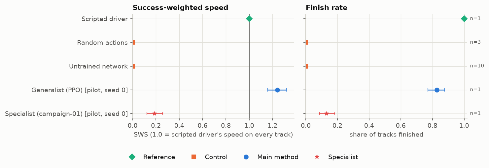

<!-- RESULTS:END -->

## Method

### The game and its physics

- **Car.** A chassis box (500 kg, 4.7 × 1.1 × 2.0 m) on four spring-damper suspension rays; tyre forces are cannon-es's side-friction and rolling-friction impulses limited by a friction circle. The engine force fades to zero at the top speed (45 m/s), braking is an impulse per tick, and steering is rate-limited and loses authority with speed. All numbers live in [`web/assets/vehicle.json`](web/assets/vehicle.json), read by both the game and the port.
- **Tick.** 100 physics ticks per second; one action is held for 5 ticks. One tick is gravity → velocity damping → `RaycastVehicle.updateVehicle` → semi-implicit Euler integration, exactly as in cannon-es ([`docs/physics.md`](docs/physics.md)).
- **Rules.** Checkpoints in order; a run is *out* when the car falls 3 m below the road, stays airborne for 5 s, or makes no 0.5 m of progress in 2 s. Players respawn at the last checkpoint with the clock running; for the agent an out ends the episode.
- **Known quirks** of cannon-es (unlimited straight-line braking grip, no rolling resistance, one ray per wheel, and a wheel touching a surface at a steep angle pushing up to 10× harder without damping) are left in on purpose and reported if agents exploit them ([`docs/physics.md`](docs/physics.md)), the way TrackMania players use "uberbugs" ([TAS Exchange FAQ](https://tmtas.exchange/faq)) and OpenAI's hide-and-seek agents learned box surfing ([Baker et al. 2020](https://arxiv.org/abs/1909.07528)).

### Tracks

A track is a ribbon in the sense of [Perantoni & Limebeer 2015](https://doi.org/10.1115/1.4028253): a centreline sampled every 2 m, a banked left vector per sample, a 12 m wide road, gaps for jumps and checkpoints. Plans follow the [TORCS track format](https://torcs.sourceforge.net/api/track_manual.html): straights and arcs with height changes and banking, plus parabolic-kicker jumps on long straights. Generated tracks are identified by seeds in disjoint ranges:

| Set | Seeds | Use |
|---|---|---|
| Training pool | 0–49,999 | training only |
| Validation | 1,000,000–1,000,199 | every development decision |
| Test | 2,000,000–2,000,999 | reported scores only; each read is logged |
| Out-of-range test | 3,000,000–3,000,199 | one factor beyond the training range |
| Unfiltered test | 2,000,000–2,000,199, without certification | secondary check that the certification filter does not flatter the score |
| Campaign | 5 hand-made | the game, the specialist experiment, and a hand-made set no generalist trains on |

A candidate track enters a set only if the scripted driver finishes it at 0.9, 1.0 and 1.1 × its target speeds; the time at 1.0 is the track's reference time.

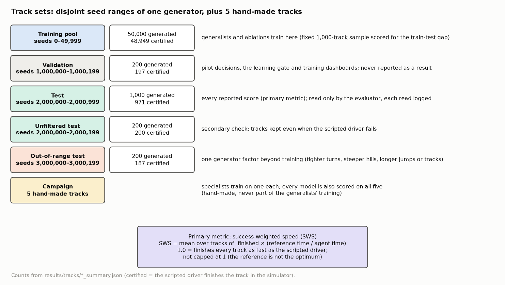

### Agent: network architecture, reward and PPO settings

The learning algorithm is PPO ([Schulman et al. 2017](https://arxiv.org/abs/1707.06347)), adapted from CleanRL's GPU script ([CleanRL](https://github.com/vwxyzjn/cleanrl), [Huang et al. 2022](https://iclr-blog-track.github.io/2022/03/25/ppo-implementation-details/)). Code: [`src/racingmania/rl/networks.py`](src/racingmania/rl/networks.py), [`src/racingmania/rl/ppo.py`](src/racingmania/rl/ppo.py), [`src/racingmania/env/obs.py`](src/racingmania/env/obs.py), [`src/racingmania/env/vec_env.py`](src/racingmania/env/vec_env.py).

**Deep-learning architecture.** An actor-critic made of two separate multilayer perceptrons with no shared layers:

- **Actor (policy):** 160 inputs → 256 tanh units → 256 tanh units → 6 outputs, read as two 3-way categorical distributions: steering (left, none, right) and pedal (gas, coast, brake). The action is the pair, one of the nine keyboard combinations; their log-probabilities and entropies are summed, as in CleanRL's multi-discrete PPO.
- **Critic (value function):** 160 inputs → 256 tanh units → 256 tanh units → 1 output, the expected discounted return.
- **Size and initialisation:** 108,550 + 107,265 = 215,815 parameters. Weights are orthogonal with gain √2 in the hidden layers, 0.01 in the actor's output layer (so the untrained policy starts close to uniform) and 1.0 in the critic's output layer (CleanRL's `layer_init`).
- **Input normalisation:** a running mean and variance of the observations, updated during training and clipped to ±10 standard deviations, frozen for evaluation and export. The browser game runs one ONNX graph that contains the observation code, this normaliser and the actor.


The diagram is drawn by [`src/racingmania/report/diagrams.py`](src/racingmania/report/diagrams.py) from the sizes in [`env/obs.py`](src/racingmania/env/obs.py) and [`rl/ppo.py`](src/racingmania/rl/ppo.py), so it changes with the code.

**Observation (160 numbers, all in the car's own frame):** velocity (3) and spin (3); the direction of gravity (3), which gives pitch and roll; steering angle (1); which wheels touch the road (4); the previous action, one-hot (6); and the next 20 centreline points, one every 6 m, so 114 m of road ahead (60), the road's left direction at each of them, which encodes heading and banking (60), and whether each is a gap to jump (20).

**Reward and episode details:**

- **Reward per agent step:** 0.1 × the metres of progress made along the road during that step. Progress is the car's position projected onto the track centreline, measured as 3D distance along the road, so driving backwards gives a negative reward. Faster driving earns the same total reward sooner, which the discount turns into a higher return.
- **Nothing else in the reward:** no time penalty, no crash penalty, no finish bonus, and no terms from the scripted driver. A per-step time cost (0.06) and a fall penalty (5.0) are tested only as ablations.
- **How a crash costs reward:** falling more than 3 m below the road, being airborne for 5 s, or making less than 0.5 m of progress in 2 s ends the episode as terminal (value 0). The agent loses all the progress it would have made after that point.
- **Finishing:** the episode also ends as terminal, after the last step's progress is counted.
- **Starts:** half of the episodes start at the official start line; the other half start at a random point on the centreline, heading along the road, at 0–30 m/s with up to half the half-width of sideways offset ([Song et al. 2021](https://arxiv.org/abs/2103.08624)).
- **Time limit:** 1,500 agent steps (75 s). A truncated episode is bootstrapped by adding γ·V(final observation) to its last reward ([Rudin et al. 2021](https://arxiv.org/abs/2109.11978)). Episodes cut off when a generalist's tracks are swapped (every 20 iterations) end at a rollout boundary, where the value of the next state continues the return as usual.

**PPO settings (the frozen recipe):**

- **Batch:** 16,384 cars in parallel × 32 steps = 524,288 agent steps per update, in 5 epochs of 4 minibatches.
- **Returns and advantages:** discount γ = 0.99 (about a 5-second horizon at 20 decisions per second) and GAE λ = 0.95. Advantages are normalised per minibatch; there is no reward normalisation.
- **Loss:** clipped surrogate objective with clip 0.2; value loss 0.5 × squared error, weight 1.0, not clipped; entropy bonus 0.01.
- **Optimiser:** Adam (eps 1e-5) with gradient-norm clipping at 1.0. The learning rate starts at 1e-3 and is adapted after every minibatch towards a KL divergence of 0.01: divided by 1.5 above 0.02, multiplied by 1.5 below 0.005, kept within 1e-5 and 1e-2 (Rudin et al. 2021).
- **Budget:** a generalist trains for 1 billion agent steps, with 4,096 tracks on the GPU at a time, swapped for a new random set every 20 iterations; a specialist trains for 200 million steps on its one track.
- **Changes from CleanRL's GPU script:** categorical action heads (the script has continuous actions only), the entropy bonus (its default is 0), the KL-adaptive learning rate and the time-limit bootstrapping (both from Rudin et al. 2021).

### The scripted driver

The scripted driver ([`src/racingmania/drivers/scripted.py`](src/racingmania/drivers/scripted.py)) is a classical controller written by hand. It is not learned, it trains nothing, and the RL agents never see its actions, states or times. Every agent step (20 times a second), on the same three-way keys as a player, it does three things:

1. **Steers by pure pursuit** ([Coulter 1992](https://publications.ri.cmu.edu/storage/publications/pub_files/pub3/coulter_r_craig_1992_1/coulter_r_craig_1992_1.pdf)). It aims at a point on the centreline a look-ahead distance ahead (0.3 s × its current speed, kept between 8 and 40 m), computes the curvature of the arc through the car and that point (κ = 2y/d², with y the point's sideways offset in the car's frame and d its distance), turns it into a front-wheel angle (atan(wheelbase × κ)), and presses left, nothing or right, whichever brings its rate-limited steering closest to that angle.
2. **Follows a speed profile** planned once per track, in the style of racing-line tools such as [TUM's trajectory_planning_helpers](https://github.com/TUMFTM/trajectory_planning_helpers). The target speed at each 2 m sample is the fastest cornering speed √(a_lat / κ) with a_lat = 6 m/s², capped at the car's top speed of 45 m/s and at 25 m/s from 30 m before a jump to its end. A backward pass then limits braking to 8 m/s², so it slows down early enough before corners.
3. **Works the pedal**: gas below the target speed, brake when more than 1.5 m/s above it, coast in between.

Only two parameters were tuned, on the validation tracks and before any training: a_lat and the look-ahead gain ([`results/tracks/scripted_tuning.json`](results/tracks/scripted_tuning.json)). The chosen a_lat = 6 m/s² is the lowest value of the grid, because faster settings finished fewer tracks at all three certification speeds (0.9, 1.0 and 1.1 × the profile). It is therefore a cautious driver, which is why the trained agents are much faster than it. Its time on a track is that track's reference time, so it scores 1.0 by construction. A generated track is kept only if it finishes at all three speeds.

### Evaluation

The primary metric is the **success-weighted speed** (SWS) on the certified tracks of the 1,000 test seeds: per track, (reference time ÷ agent time) if the agent finishes within 3 × the reference time, else 0, averaged over tracks. It adapts SPL ([Anderson et al. 2018](https://arxiv.org/abs/1807.06757)) from path length to time. Every run is scored once, from the standing start with its most probable action, at the final checkpoint (never the best one): generalist-type runs on validation, their own training tracks, campaign, test, out-of-range and unfiltered test tracks; specialists on the campaign and test tracks ([run matrix](configs/run_matrix.yaml)). Baselines: random actions, an untrained network, the scripted driver (1.0 by construction) and a CEM planner as a planning reference (its 4.5 s horizon was chosen on validation tracks; it is not a near-optimal bound). Controls: a blind agent without the look-ahead and agents trained on 1–10,000 tracks. The evaluator also flags possible physics exploits (speed above 1.2 × top speed, energy gained while coasting), and each flag is checked by replaying the run ([`scripts/10_diagnose_flag.py`](scripts/10_diagnose_flag.py)). Hypotheses and tests are in the [preregistration](reports/preregistration.md); later changes are dated amendments there and in the [plan](reports/plan.md).

## Architecture

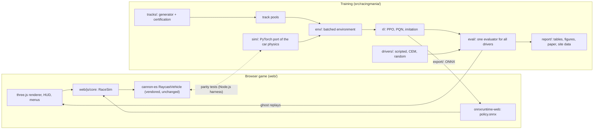

### What happens when you run the pipeline

1. `01_generate_tracks.py` tunes the scripted driver on validation candidates, generates every set in parallel, drives each candidate to certify it, and saves the sets as pools (large files under `RACINGMANIA_DATA_DIR`) with summaries in `results/tracks/`.
2. `02_train.py` trains one run on the GPU, logging to the terminal, a timestamped log file, `results/<run>/train_metrics.csv` and TensorBoard, evaluating on validation tracks every 10 minutes and checkpointing every 10 minutes (it resumes automatically after a crash or reboot).
3. `03_evaluate.py` scores the final checkpoint on the chosen sets with the common evaluator and writes per-track CSVs; reading the test sets is logged.
4. `04_baselines.py` scores the training-free baselines the same way.
5. `06_export_web.py` exports the policy to ONNX (checked against PyTorch), copies the AI's runs as ghosts, and registers both in the game.
6. `07_make_report.py` regenerates every table, figure, report, the paper, this README's results block and the results website from the result files.
7. `05_run_matrix.py` runs all of the above for every run of the [run matrix](configs/run_matrix.yaml), publishing to GitHub and Hugging Face before training, after training and after evaluation (paused since 2026-11-14; see [Reproduce](#reproduce)).

## Install

Requirements: Windows 11 or Linux, an NVIDIA GPU with a recent driver (training used an RTX 5070 Laptop GPU, 8 GB), [uv](https://docs.astral.sh/uv/), Node.js ≥ 20 (for the parity tests), and optionally WSL2 on Windows (training there is about 10× faster because `torch.compile` works).

```bash
git clone https://github.com/BurnyCoder/reinforcement-learning-in-trackmania-like-racing-game.git
```

```bash
cd reinforcement-learning-in-trackmania-like-racing-game
```

```bash
uv sync
```

```bash
npm install
```

Copy `.env.example` to `.env` and set `RACINGMANIA_DATA_DIR` to a folder with ~20 GB free. PyTorch is installed from the CUDA 13.2 wheel index configured in `pyproject.toml`.

In WSL2, keep the Linux virtual environment on the Linux file system:

```bash
export UV_PROJECT_ENVIRONMENT=$HOME/venvs/racingmania && uv sync
```

## Play

Online: <https://burnycoder.github.io/reinforcement-learning-in-trackmania-like-racing-game/> (deployed from `web/` by `.github/workflows/pages.yml` on every push to `main`). Locally:

```bash
uv run python -m http.server 8123 --directory web
```

Then open <http://localhost:8123/>. Arrows or WASD drive (up = gas, down = brake/reverse), Enter or R restarts, Backspace respawns at the last checkpoint, Esc returns to the menu. Each run starts with a 1.5 s "3, 2, 1, GO!" countdown during which the clock stays at zero; keys held during the countdown, or held through a restart, act from the first physics tick, so holding gas gives a full-throttle start. Besides the five campaign tracks, the menu has five held-out tracks (four test tracks and one out-of-range track, added by [`scripts/12_export_unseen_track.py`](scripts/12_export_unseen_track.py)) on which you can race the generalist on tracks it never saw. Each track's panel has an AI drivers table: every exported network and every recorded official run on that track (including the scripted driver's and runs that fell off), best time on that track first, with its medal, whether it was trained on that track, and a ghost toggle. The chosen driver is the one "Race vs AI" and "Watch AI" run live in the browser, and whose recorded run "Watch replay" plays.

## Reproduce

```bash
uv run pytest tests/unit tests/parity -q
```

```bash
uv run python scripts/bench_sim.py --compile
```

```bash
uv run python scripts/01_generate_tracks.py
```

```bash
uv run python scripts/04_baselines.py --sets val train_sample campaign test oor test_unfiltered --cem
```

```bash
uv run python scripts/05_run_matrix.py
```

```bash
uv run python scripts/07_make_report.py
```

**Resuming the paused training.** Training was paused on 2026-11-14 (`paused` block in [`configs/run_matrix.yaml`](configs/run_matrix.yaml)); while that block is present the queue does not start, and the report lists the runs without results as postponed. To resume, delete the block and run `uv run python scripts/05_run_matrix.py --phases 2-single-seed 4-imitation-hybrids 5-hyperparameters 6-seed-sensitivity` (Windows; GPU work runs in WSL). The queue skips evaluated runs, resumes interrupted ones from their checkpoints, and publishes before training, after training and after evaluation. Phase 4 first needs its focused literature search and a preregistration amendment fixing the imitation and hybrid variants ([`reports/plan.md`](reports/plan.md)).

Single runs: `uv run python scripts/02_train.py --experiment generalist --seed 1`, then `uv run python scripts/03_evaluate.py --experiment generalist --seed 1 --sets val train_sample train_own campaign test oor test_unfiltered`. Live dashboard during training: `uv run tensorboard --logdir <RACINGMANIA_DATA_DIR>/tensorboard`.

Diagnostics: `scripts/09_failure_analysis.py --run generalist/seed0 --sets val` writes where a run's failures happen (sharpest turn and jumps in the 60 m before each fall, against random places) to `results/<run>/failures_<set>.json`; `scripts/10_diagnose_flag.py --experiment generalist --seed 0 --set train_sample --track train-198` replays an exploit-flagged track step by step with its translational, gravitational and rotational energy; `scripts/tune_cem.py 30 60 90` compares CEM planning horizons on validation tracks.

Videos: `scripts/12_export_unseen_track.py --run generalist/seed0 --split test --rule best median_jump mid_fail --ghosts scripted run` adds the held-out test tracks chosen by fixed rules (best lap, typical lap, fall closest to mid-track) to the game menu, together with the scripted driver's and the generalist's official runs on them as ghosts (each checked tick for tick against its result file); `scripts/06_export_web.py --run baselines/untrained/seed0` exports the untrained control; `scripts/11_record_videos.py` then records every clip of [`docs/videos/clips.yaml`](docs/videos/clips.yaml) with Playwright and ffmpeg (game served on port 8123) and rewrites the video section above (`--captions-only` rewrites only the labels).

## Features

- Playable browser game: five campaign tracks and five held-out tracks, a 3-2-1 start countdown, medals, splits, your best ghost, an AI drivers table sorted by time (every network and recorded run with its medal and ghost toggle), race against a live AI driver, and replays of the official evaluation runs.
- One physics implementation for game and training, with tick-by-tick parity tests against the original.
- GPU simulator with `torch.compile` in WSL2 (16,384 cars in parallel): a 1-billion-step generalist run took about 1.3 hours of training on an RTX 5070 Laptop GPU (each run's wall time is in `results/<run>/run.json`; `scripts/bench_sim.py` measures the simulator alone).
- Exploit detectors with step-by-step replays, failure-position analysis, and generated videos of the agents' laps.
- Seeded track generator with certification by driving and disjoint train/validation/test seed ranges.
- PPO, PQN, behaviour cloning, DAgger and hybrid variants; scripted, random, untrained and CEM baselines.
- Resumable training, timestamped logs, TensorBoard dashboard, one-command reports, paper-style diagrams (architecture, system, protocol, run status) and paper.
- Hugging Face model cards with videos of each model's official evaluation runs, published automatically with the models.

## Technologies

Python 3.13, PyTorch 2.15 (CUDA 13.2), `torch.compile`/Triton, NumPy, SciPy, Matplotlib, TensorBoard, ONNX and onnxruntime, Hugging Face Hub; JavaScript ES modules, three.js r187, cannon-es 0.20.0, onnxruntime-web 1.31.1; Node.js for the parity harness; Playwright for browser tests; uv; pandoc and typst for the paper.

## Licence

MIT for this project's code (see `LICENSE`). Third-party code and its licences are listed in [`THIRD_PARTY_NOTICES.md`](THIRD_PARTY_NOTICES.md).
