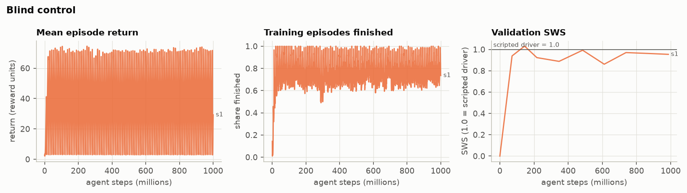

# Blind control

_Generated by `uv run python scripts/07_make_report.py` from the files in `results/` on 2026-11-14. Do not edit by hand; hand-written notes go in `reports/notes/`._

**Question.** Does the agent use the look-ahead (H3)?

## Methodology

The generalist recipe with the upcoming-track points removed from the observation (the nearest centreline point stays). Generalist minus blind on the test tracks is H3.

Metric: success-weighted speed (SWS) and finish rate; intervals are 95 % two-level bootstrap intervals (10,000 resamples of seeds and tracks). See `reports/preregistration.md` for the binding protocol.

## Runs

| Run | Status | Phase | Agent steps | Wall hours | Physics | Commit | Evaluated on |
|---|---|---|---|---|---|---|---|
| `blind/seed1` | evaluated | 2-single-seed | 1,000,341,504 | 1.62 | v1 | 62d58e9cec | test, val, train_sample, train_own, oor, campaign, test_unfiltered |
| `blind/seed2` | not started | 6-seed-sensitivity | — | — | v1 | — | — |
| `blind/seed3` | not started | 6-seed-sensitivity | — | — | v1 | — | — |
| `blind/seed4` | not started | 6-seed-sensitivity | — | — | v1 | — | — |
| `blind/seed5` | not started | 6-seed-sensitivity | — | — | v1 | — | — |

## Configuration (logged in each run.json)

| Run | total_steps | num_envs | num_steps | lr | gamma | gae_lambda | ent_coef | clip_coef | hidden | action_mode | weight_decay | loaded_tracks | window_k | blind | time_cost | fall_penalty | random_start_prob | max_steps | hint_weight | scripted_starts | training tracks |
|---|---|---|---|---|---|---|---|---|---|---|---|---|---|---|---|---|---|---|---|---|---|
| `blind/seed1` | 1000000000 | 16384 | 32 | 0.001 | 0.99 | 0.95 | 0.01 | 0.2 | [256, 256] | factored | 0.0 | 4096 | 20 | True | 0.0 | 0.0 | 0.5 | 1500 | 0.0 | False | 48949 |

## Results

### Scores

| Configuration | Role | Seeds | Test SWS [95 % CI] | Test finished | Val SWS [95 % CI] | Val finished | Train SWS [95 % CI] | Train finished | Own train SWS [95 % CI] | Own train finished | OOR SWS [95 % CI] | OOR finished | Campaign SWS [95 % CI] | Campaign finished | Unfiltered SWS [95 % CI] | Unfiltered finished |
|---|---|---|---|---|---|---|---|---|---|---|---|---|---|---|---|---|
| Scripted driver | Reference | 1 | 0.998 [0.995, 1.000] | 99.8 % | 1.000 [1.000, 1.000] | 100.0 % | 0.999 [0.997, 1.000] | 99.9 % | — | — | 1.000 [1.000, 1.000] | 100.0 % | 1.000 [1.000, 1.000] | 100.0 % | 1.000 [1.000, 1.000] | 100.0 % |
| Blind control | Control | 1 | 1.010 [0.971, 1.048] | 73.3 % | 1.003 [0.913, 1.086] | 72.6 % | 1.008 [0.970, 1.046] | 73.2 % | 1.008 [0.970, 1.046] | 73.2 % | 0.605 [0.506, 0.703] | 43.9 % | 1.443 [1.321, 1.590] | 100.0 % | 1.022 [0.934, 1.109] | 73.5 % |
| Generalist (PPO) | Main method | 1 | 1.214 [1.177, 1.250] | 81.5 % | 1.236 [1.153, 1.315] | 82.7 % | 1.250 [1.214, 1.283] | 83.9 % | 1.250 [1.214, 1.283] | 83.9 % | 0.875 [0.769, 0.982] | 57.8 % | 1.590 [1.451, 1.783] | 100.0 % | 1.231 [1.147, 1.311] | 82.0 % |

Rows from other groups are shown for comparison. Track counts: Test (unseen generated): 971 tracks; Validation: 197 tracks; Training sample: 1,000 tracks; Own training tracks: 1,000 tracks; Out-of-range test: 187 tracks; Campaign (hand-made): 5 tracks; Unfiltered test: 200 tracks.

### Hypotheses

|  | Hypothesis | Tested quantity | Seeds (have/required) | Estimate [95 % CI] | Test statistic | p (one-sided) | p (Holm) | Decision |
|---|---|---|---|---|---|---|---|---|
| H1 | The generalist drives unseen tracks better than the scripted driver | SWS > 1.0 | generalist 1/10 | 1.214 [1.177, 1.250] (preliminary) | — | — | — | **not yet tested** |
| H2 | Track diversity is what generalises (50,000 tracks vs 1 track) | SWS difference > 0.1 | generalist 1/10, size-1 0/5 | — | — | — | — | **not yet tested** |
| H3 | The agent uses the look-ahead (generalist vs blind control) | SWS difference > 0.1 | generalist 1/10, blind 1/5 | 0.204 [0.164, 0.245] (preliminary) | — | — | — | **not yet tested** |

### Training curves

*Training curves of Blind control; one line per seed (seeds 1). Return and finish rate are over training episodes (standing and random starts); validation SWS is the evaluator's score on the validation tracks.*

## Learnings

_No hand-written notes yet (add `reports/notes/blind-control.md`)._
