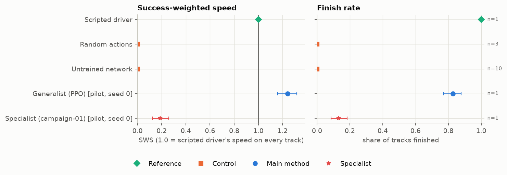
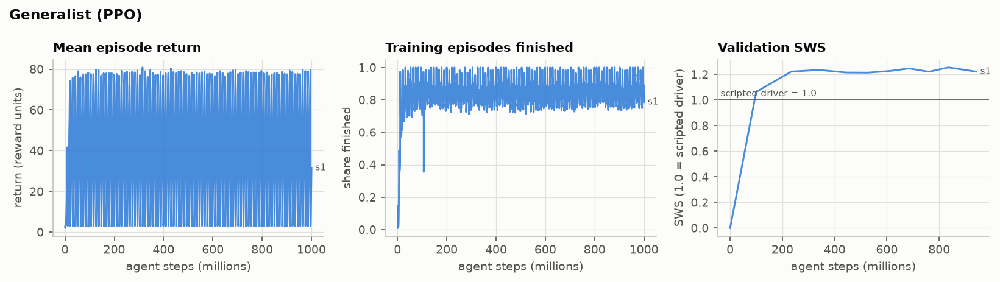

# Generalist

_Generated by `uv run python scripts/07_make_report.py` from the files in `results/` on 2026-11-15. Do not edit by hand; hand-written notes go in `reports/notes/`._

**Question.** Can one policy trained on the generated pool drive unseen tracks (H1)?

## Methodology

The standard recipe (PPO, separate 2-layer actor and critic, two 3-way action heads, progress reward, standing and random starts) trained on the whole generated training pool; evaluated with the checkpoint at the end of the step budget, most probable action, one run per track from a standing start.

Metric: success-weighted speed (SWS) and finish rate; intervals are 95 % two-level bootstrap intervals (10,000 resamples of seeds and tracks). See `reports/preregistration.md` for the binding protocol.

## Runs

| Run | Status | Phase | Agent steps | Wall hours | Physics | Commit | Evaluated on |
|---|---|---|---|---|---|---|---|
| `generalist/seed1` | evaluated | 2-single-seed | 1,000,341,504 | 1.92 | v1 | a861208dbc | test, val, train_sample, train_own, oor, campaign, test_unfiltered |
| `generalist/seed2` | postponed | 6-seed-sensitivity | — | — | v1 | — | — |
| `generalist/seed3` | postponed | 6-seed-sensitivity | — | — | v1 | — | — |
| `generalist/seed4` | postponed | 6-seed-sensitivity | — | — | v1 | — | — |
| `generalist/seed5` | postponed | 6-seed-sensitivity | — | — | v1 | — | — |
| `generalist/seed6` | postponed | 6-seed-sensitivity | — | — | v1 | — | — |
| `generalist/seed7` | postponed | 6-seed-sensitivity | — | — | v1 | — | — |
| `generalist/seed8` | postponed | 6-seed-sensitivity | — | — | v1 | — | — |
| `generalist/seed9` | postponed | 6-seed-sensitivity | — | — | v1 | — | — |
| `generalist/seed10` | postponed | 6-seed-sensitivity | — | — | v1 | — | — |

## Configuration (logged in each run.json)

| Run | total_steps | num_envs | num_steps | lr | gamma | gae_lambda | ent_coef | clip_coef | hidden | action_mode | weight_decay | loaded_tracks | window_k | blind | time_cost | fall_penalty | random_start_prob | max_steps | hint_weight | scripted_starts | training tracks |
|---|---|---|---|---|---|---|---|---|---|---|---|---|---|---|---|---|---|---|---|---|---|
| `generalist/seed1` | 1000000000 | 16384 | 32 | 0.001 | 0.99 | 0.95 | 0.01 | 0.2 | [256, 256] | factored | 0.0 | 4096 | 20 | False | 0.0 | 0.0 | 0.5 | 1500 | 0.0 | False | 48949 |

## Results

### Scores

| Configuration | Role | Seeds | Test SWS [95 % CI] | Test finished | Val SWS [95 % CI] | Val finished | Train SWS [95 % CI] | Train finished | Own train SWS [95 % CI] | Own train finished | OOR SWS [95 % CI] | OOR finished | Campaign SWS [95 % CI] | Campaign finished | Unfiltered SWS [95 % CI] | Unfiltered finished |
|---|---|---|---|---|---|---|---|---|---|---|---|---|---|---|---|---|
| Scripted driver | Reference | 1 | 0.998 [0.995, 1.000] | 99.8 % | 1.000 [1.000, 1.000] | 100.0 % | 0.999 [0.997, 1.000] | 99.9 % | — | — | 1.000 [1.000, 1.000] | 100.0 % | 1.000 [1.000, 1.000] | 100.0 % | 1.000 [1.000, 1.000] | 100.0 % |
| Random actions | Control | 3 | 0.000 [0.000, 0.000] | 0.0 % | 0.000 [0.000, 0.000] | 0.0 % | 0.000 [0.000, 0.000] | 0.0 % | — | — | 0.000 [0.000, 0.000] | 0.0 % | 0.000 [0.000, 0.000] | 0.0 % | 0.000 [0.000, 0.000] | 0.0 % |
| Untrained network | Control | 10 | 0.000 [0.000, 0.000] | 0.0 % | 0.000 [0.000, 0.000] | 0.0 % | 0.000 [0.000, 0.000] | 0.0 % | — | — | 0.000 [0.000, 0.000] | 0.0 % | 0.000 [0.000, 0.000] | 0.0 % | 0.000 [0.000, 0.000] | 0.0 % |
| Blind control | Control | 1 | 1.010 [0.971, 1.048] | 73.3 % | 1.003 [0.913, 1.086] | 72.6 % | 1.008 [0.970, 1.046] | 73.2 % | 1.008 [0.970, 1.046] | 73.2 % | 0.605 [0.506, 0.703] | 43.9 % | 1.443 [1.321, 1.590] | 100.0 % | 1.022 [0.934, 1.109] | 73.5 % |
| Generalist (PPO) | Main method | 1 | 1.214 [1.177, 1.250] | 81.5 % | 1.236 [1.153, 1.315] | 82.7 % | 1.250 [1.214, 1.283] | 83.9 % | 1.250 [1.214, 1.283] | 83.9 % | 0.875 [0.769, 0.982] | 57.8 % | 1.590 [1.451, 1.783] | 100.0 % | 1.231 [1.147, 1.311] | 82.0 % |
| Trained on 1 track | Ablation | 1 | 0.539 [0.495, 0.583] | 36.5 % | 0.508 [0.408, 0.607] | 34.0 % | 0.499 [0.455, 0.545] | 33.5 % | 1.636 [1.636, 1.636] | 100.0 % | 0.214 [0.142, 0.291] | 14.4 % | 0.584 [0.000, 1.184] | 40.0 % | 0.544 [0.445, 0.644] | 36.0 % |

Rows from other groups are shown for comparison. Track counts: Test (unseen generated): 971 tracks; Validation: 197 tracks; Training sample: 1,000 tracks; Own training tracks: 1, 1,000 tracks; Out-of-range test: 187 tracks; Campaign (hand-made): 5 tracks; Unfiltered test: 200 tracks.

### Comparison of all configurations

*SWS and finish rate on the test set (971 tracks), mean over seeds with 95 % two-level bootstrap intervals (10,000 resamples of seeds and tracks); n = number of seeds. With one seed the interval reflects track sampling only.*

### Hypotheses

|  | Hypothesis | Tested quantity | Seeds (have/required) | Estimate [95 % CI] | Test statistic | p (one-sided) | p (Holm) | Decision | Preliminary reading (not a test) |
|---|---|---|---|---|---|---|---|---|---|
| H1 | The generalist drives unseen tracks better than the scripted driver | SWS > 1.0 | generalist 1/10 | 1.214 [1.177, 1.250] (preliminary) | — | — | — | **not yet tested** | preliminary (1 seed, track resampling only): the interval lies above 1.0, consistent with H1 |
| H2 | Track diversity is what generalises (the whole training pool, 48,949 tracks from 50,000 seeds, vs 1 track) | SWS difference > 0.1 | generalist 1/10, size-1 1/5 | 0.675 [0.624, 0.727] (preliminary) | — | — | — | **not yet tested** | preliminary (1 seed per group, track resampling only): the interval lies above 0.1, consistent with H2 |
| H3 | The agent uses the look-ahead (generalist vs blind control) | SWS difference > 0.1 | generalist 1/10, blind 1/5 | 0.204 [0.164, 0.245] (preliminary) | — | — | — | **not yet tested** | preliminary (1 seed per group, track resampling only): the interval lies above 0.1, consistent with H3 |

### Cross-checks (Agarwal et al. 2021)

| Generalist vs | Set | Seeds (generalist / other) | IQM generalist | IQM other | P(generalist > other) | Time ratio where both finish | Tracks both finish |
|---|---|---|---|---|---|---|---|
| Trained on 1 track | test | 1 / 1 | 1.464 | 0.318 | 0.604 | 1.015 | 332 |
| Blind control | test | 1 / 1 | 1.464 | 1.291 | 0.874 | 0.927 | 650 |
| PQN | test | 1 / 1 | 1.464 | 1.295 | 0.854 | 0.886 | 671 |
| Scripted driver | test | 1 / 1 | 1.464 | 1.000 | 0.815 | 0.673 | 790 |
| Random actions | test | 1 / 3 | 1.464 | 0.000 | 0.907 | — | 0 |
| Untrained network | test | 1 / 10 | 1.464 | 0.000 | 0.907 | — | 0 |

### Finish rate by track feature

*Finish rate by track feature on the test set: jumps counted per track, banking and height range split into tertiles of that set (ranges in the labels). Mean over seeds and tracks in each bin with 95 % two-level bootstrap intervals. Secondary, descriptive analysis.*

### Exploit flags

| Configuration | Set | Overspeed flags | Coasting energy-gain flags | Seeds | Tracks |
|---|---|---|---|---|---|
| Untrained network | OOR | 0 | 1 | 10 | 187 |
| Blind control | Own train | 0 | 2 | 1 | 1000 |
| Blind control | Train | 0 | 2 | 1 | 1000 |
| Blind control | Val | 0 | 1 | 1 | 197 |
| Generalist (PPO) [pilot, seed 0] | Train | 0 | 3 | 1 | 1000 |
| Generalist (PPO) | OOR | 0 | 3 | 1 | 187 |
| Generalist (PPO) | Test | 0 | 1 | 1 | 971 |
| PQN | Test | 0 | 1 | 1 | 971 |
| PQN | Own train | 0 | 1 | 1 | 1000 |
| PQN | Train | 0 | 1 | 1 | 1000 |
| Trained on 1 track | OOR | 0 | 1 | 1 | 187 |
| Trained on 1 track | Test | 0 | 4 | 1 | 971 |
| Trained on 1 track | Unfiltered | 0 | 2 | 1 | 200 |
| Trained on 1 track | Train | 0 | 4 | 1 | 1000 |
| Specialist (campaign-02) | Test | 0 | 3 | 1 | 971 |
| Specialist (campaign-03) | Test | 0 | 2 | 1 | 971 |
| Specialist (campaign-04) | Test | 0 | 6 | 1 | 971 |
| Specialist (campaign-05) | Test | 0 | 4 | 1 | 971 |
| Fine-tuned specialist (campaign-02) | Test | 0 | 2 | 1 | 971 |
| Fine-tuned specialist (campaign-03) | Test | 0 | 4 | 1 | 971 |
| Fine-tuned specialist (campaign-04) | Test | 0 | 2 | 1 | 971 |

### Training curves

*Training curves of Generalist (PPO); one line per seed (seeds 1). Return and finish rate are over training episodes (standing and random starts); validation SWS is the evaluator's score on the validation tracks.*

## Learnings

_No hand-written notes yet (add `reports/notes/generalist.md`)._
