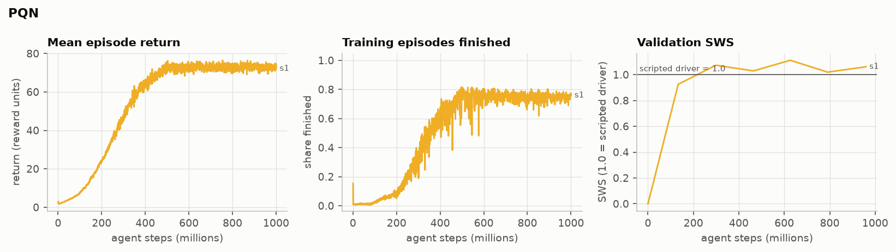

# Baseline algorithm: PQN

_Generated by `uv run python scripts/07_make_report.py` from the files in `results/` on 2026-11-15. Do not edit by hand; hand-written notes go in `reports/notes/`._

**Question.** Does the result depend on PPO?

## Methodology

PQN (Gallici et al. 2025, adapted from CleanRL's pqn.py) with the same inputs, reward, rollout size, normaliser and step budget, and a single 9-way action head; the PPO ablation with a 9-way head isolates the action parameterisation.

Metric: success-weighted speed (SWS) and finish rate; intervals are 95 % two-level bootstrap intervals (10,000 resamples of seeds and tracks). See `reports/preregistration.md` for the binding protocol.

## Runs

| Run | Status | Phase | Agent steps | Wall hours | Physics | Commit | Evaluated on |
|---|---|---|---|---|---|---|---|
| `pqn/seed1` | evaluated | 2-single-seed | 1,000,341,504 | 1.10 | v1 | 70a35809b4 | test, val, train_sample, train_own, oor, campaign, test_unfiltered |
| `pqn/seed2` | postponed | 6-seed-sensitivity | — | — | v1 | — | — |
| `pqn/seed3` | postponed | 6-seed-sensitivity | — | — | v1 | — | — |

## Configuration (logged in each run.json)

| Run | total_steps | num_envs | num_steps | lr | gamma | gae_lambda | ent_coef | clip_coef | hidden | action_mode | weight_decay | loaded_tracks | window_k | blind | time_cost | fall_penalty | random_start_prob | max_steps | hint_weight | scripted_starts | training tracks |
|---|---|---|---|---|---|---|---|---|---|---|---|---|---|---|---|---|---|---|---|---|---|
| `pqn/seed1` | 1000000000 | 16384 | 32 | 0.00025 | 0.99 | 0.95 | 0.01 | 0.2 | [256, 256] | joint | 0.0 | 4096 | 20 | False | 0.0 | 0.0 | 0.5 | 1500 | 0.0 | False | 48949 |

## Results

### Scores

| Configuration | Role | Seeds | Test SWS [95 % CI] | Test finished | Val SWS [95 % CI] | Val finished | Train SWS [95 % CI] | Train finished | Own train SWS [95 % CI] | Own train finished | OOR SWS [95 % CI] | OOR finished | Campaign SWS [95 % CI] | Campaign finished | Unfiltered SWS [95 % CI] | Unfiltered finished |
|---|---|---|---|---|---|---|---|---|---|---|---|---|---|---|---|---|
| Generalist (PPO) | Main method | 1 | 1.214 [1.177, 1.250] | 81.5 % | 1.236 [1.153, 1.315] | 82.7 % | 1.250 [1.214, 1.283] | 83.9 % | 1.250 [1.214, 1.283] | 83.9 % | 0.875 [0.769, 0.982] | 57.8 % | 1.590 [1.451, 1.783] | 100.0 % | 1.231 [1.147, 1.311] | 82.0 % |
| PQN | Baseline algorithm | 1 | 1.054 [1.020, 1.086] | 79.8 % | 1.034 [0.956, 1.109] | 78.2 % | 1.052 [1.019, 1.085] | 79.7 % | 1.052 [1.019, 1.085] | 79.7 % | 0.725 [0.631, 0.820] | 55.1 % | 1.391 [1.270, 1.517] | 100.0 % | 1.105 [1.035, 1.173] | 83.0 % |

Rows from other groups are shown for comparison. Track counts: Test (unseen generated): 971 tracks; Validation: 197 tracks; Training sample: 1,000 tracks; Own training tracks: 1, 1,000 tracks; Out-of-range test: 187 tracks; Campaign (hand-made): 5 tracks; Unfiltered test: 200 tracks.

### Training curves

*Training curves of PQN; one line per seed (seeds 1). Return and finish rate are over training episodes (standing and random starts); validation SWS is the evaluator's score on the validation tracks.*

## Learnings

_No hand-written notes yet (add `reports/notes/pqn.md`)._
