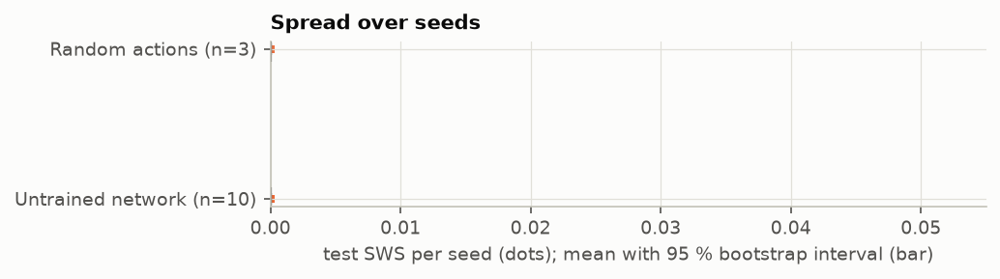

# Seed sensitivity (phase 6)

_Generated by `uv run python scripts/07_make_report.py` from the files in `results/` on 2026-11-14. Do not edit by hand; hand-written notes go in `reports/notes/`._

**Question.** How much do results vary between seeds, and do the single-seed results hold?

## Methodology

Earlier runs repeated with new seeds and nothing else changed. For every configuration: minimum, maximum and standard deviation over seeds and the share of variance from seeds versus tracks; whether each single-seed comparison keeps its sign; and the formal tests of H1-H3.

Metric: success-weighted speed (SWS) and finish rate; intervals are 95 % two-level bootstrap intervals (10,000 resamples of seeds and tracks). See `reports/preregistration.md` for the binding protocol.

## Results

### Spread over seeds (test set)

| Configuration | Seeds | Mean SWS | Min | Max | SD | Variance: seeds | Variance: tracks | Variance: seed x track | Tracks |
|---|---|---|---|---|---|---|---|---|---|
| Random actions | 3 | 0.000 | 0.000 | 0.000 | 0.000 | — | — | — | 971 |
| Untrained network | 10 | 0.000 | 0.000 | 0.000 | 0.000 | — | — | — | 971 |

*Seed sensitivity: test SWS of every seed (dots) and the mean with its 95 % two-level bootstrap interval, for every configuration with at least two seeds.*

### Do single-seed comparisons hold?

_Not yet available: needs test results from two or more seeds of a configuration and of the generalist._

### Hypotheses

|  | Hypothesis | Tested quantity | Seeds (have/required) | Estimate [95 % CI] | Test statistic | p (one-sided) | p (Holm) | Decision |
|---|---|---|---|---|---|---|---|---|
| H1 | The generalist drives unseen tracks better than the scripted driver | SWS > 1.0 | generalist 0/10 | — | — | — | — | **not yet tested** |
| H2 | Track diversity is what generalises (50,000 tracks vs 1 track) | SWS difference > 0.1 | generalist 0/10, size-1 0/5 | — | — | — | — | **not yet tested** |
| H3 | The agent uses the look-ahead (generalist vs blind control) | SWS difference > 0.1 | generalist 0/10, blind 0/5 | — | — | — | — | **not yet tested** |

### Cross-checks (Agarwal et al. 2021)

_Not yet available: the runs behind this table have no results yet._

## Learnings

_No hand-written notes yet (add `reports/notes/seed-sensitivity.md`)._
