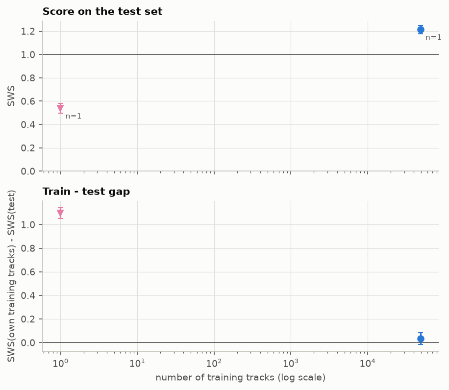
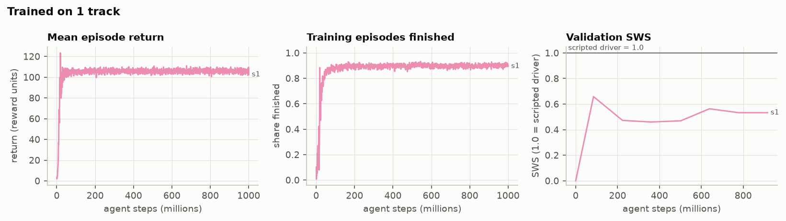

# Training-set size

_Generated by `uv run python scripts/07_make_report.py` from the files in `results/` on 2026-11-15. Do not edit by hand; hand-written notes go in `reports/notes/`._

**Question.** Is track diversity what generalises (H2)?

## Methodology

The generalist recipe trained on only N tracks drawn from the training pool with the run's seed. SWS(whole pool) minus SWS(1 track) on the test tracks is H2; the curve over N and the train-test gap follow Kirk et al. 2023 and Cobbe et al. 2019/2020.

Metric: success-weighted speed (SWS) and finish rate; intervals are 95 % two-level bootstrap intervals (10,000 resamples of seeds and tracks). See `reports/preregistration.md` for the binding protocol.

## Runs

| Run | Status | Phase | Agent steps | Wall hours | Physics | Commit | Evaluated on |
|---|---|---|---|---|---|---|---|
| `size-1/seed1` | evaluated | 2-single-seed | 1,000,341,504 | 1.33 | v1 | 3e75ae37db | test, val, train_sample, train_own, oor, campaign, test_unfiltered |
| `size-10/seed1` | postponed | 2-single-seed | — | — | v1 | — | — |
| `size-100/seed1` | postponed | 2-single-seed | — | — | v1 | — | — |
| `size-1000/seed1` | postponed | 2-single-seed | — | — | v1 | — | — |
| `size-10000/seed1` | postponed | 2-single-seed | — | — | v1 | — | — |
| `size-1/seed2` | postponed | 6-seed-sensitivity | — | — | v1 | — | — |
| `size-1/seed3` | postponed | 6-seed-sensitivity | — | — | v1 | — | — |
| `size-1/seed4` | postponed | 6-seed-sensitivity | — | — | v1 | — | — |
| `size-1/seed5` | postponed | 6-seed-sensitivity | — | — | v1 | — | — |
| `size-10/seed2` | postponed | 6-seed-sensitivity | — | — | v1 | — | — |
| `size-10/seed3` | postponed | 6-seed-sensitivity | — | — | v1 | — | — |
| `size-100/seed2` | postponed | 6-seed-sensitivity | — | — | v1 | — | — |
| `size-100/seed3` | postponed | 6-seed-sensitivity | — | — | v1 | — | — |
| `size-1000/seed2` | postponed | 6-seed-sensitivity | — | — | v1 | — | — |
| `size-1000/seed3` | postponed | 6-seed-sensitivity | — | — | v1 | — | — |
| `size-10000/seed2` | postponed | 6-seed-sensitivity | — | — | v1 | — | — |
| `size-10000/seed3` | postponed | 6-seed-sensitivity | — | — | v1 | — | — |

## Configuration (logged in each run.json)

| Run | total_steps | num_envs | num_steps | lr | gamma | gae_lambda | ent_coef | clip_coef | hidden | action_mode | weight_decay | loaded_tracks | window_k | blind | time_cost | fall_penalty | random_start_prob | max_steps | hint_weight | scripted_starts | training tracks |
|---|---|---|---|---|---|---|---|---|---|---|---|---|---|---|---|---|---|---|---|---|---|
| `size-1/seed1` | 1000000000 | 16384 | 32 | 0.001 | 0.99 | 0.95 | 0.01 | 0.2 | [256, 256] | factored | 0.0 | 4096 | 20 | False | 0.0 | 0.0 | 0.5 | 1500 | 0.0 | False | 1 |

## Results

### Scores

| Configuration | Role | Seeds | Test SWS [95 % CI] | Test finished | Val SWS [95 % CI] | Val finished | Train SWS [95 % CI] | Train finished | Own train SWS [95 % CI] | Own train finished | OOR SWS [95 % CI] | OOR finished | Campaign SWS [95 % CI] | Campaign finished | Unfiltered SWS [95 % CI] | Unfiltered finished |
|---|---|---|---|---|---|---|---|---|---|---|---|---|---|---|---|---|
| Scripted driver | Reference | 1 | 0.998 [0.995, 1.000] | 99.8 % | 1.000 [1.000, 1.000] | 100.0 % | 0.999 [0.997, 1.000] | 99.9 % | — | — | 1.000 [1.000, 1.000] | 100.0 % | 1.000 [1.000, 1.000] | 100.0 % | 1.000 [1.000, 1.000] | 100.0 % |
| Generalist (PPO) | Main method | 1 | 1.214 [1.177, 1.250] | 81.5 % | 1.236 [1.153, 1.315] | 82.7 % | 1.250 [1.214, 1.283] | 83.9 % | 1.250 [1.214, 1.283] | 83.9 % | 0.875 [0.769, 0.982] | 57.8 % | 1.590 [1.451, 1.783] | 100.0 % | 1.231 [1.147, 1.311] | 82.0 % |
| Trained on 1 track | Ablation | 1 | 0.539 [0.495, 0.583] | 36.5 % | 0.508 [0.408, 0.607] | 34.0 % | 0.499 [0.455, 0.545] | 33.5 % | 1.636 [1.636, 1.636] | 100.0 % | 0.214 [0.142, 0.291] | 14.4 % | 0.584 [0.000, 1.184] | 40.0 % | 0.544 [0.445, 0.644] | 36.0 % |

Rows from other groups are shown for comparison. Track counts: Test (unseen generated): 971 tracks; Validation: 197 tracks; Training sample: 1,000 tracks; Own training tracks: 1, 1,000 tracks; Out-of-range test: 187 tracks; Campaign (hand-made): 5 tracks; Unfiltered test: 200 tracks.

### Score and train-test gap against the number of training tracks

| Training tracks | Configuration | Seeds | SWS [95 % CI] | Train - test gap [95 % CI] | Training score from |
|---|---|---|---|---|---|
| 1 | Trained on 1 track | 1 | 0.539 [0.495, 0.583] | 1.097 [1.051, 1.142] | train_own |
| 48,949 | Generalist (PPO) | 1 | 1.214 [1.177, 1.250] | 0.036 [-0.015, 0.086] | train_own |

*Training-set-size ablation: score (top) and train-test gap (bottom) against the number of training tracks; the largest value is the generalist trained on the whole pool. Mean over seeds (n per point) with 95 % two-level bootstrap intervals.*

### Hypotheses

|  | Hypothesis | Tested quantity | Seeds (have/required) | Estimate [95 % CI] | Test statistic | p (one-sided) | p (Holm) | Decision | Preliminary reading (not a test) |
|---|---|---|---|---|---|---|---|---|---|
| H1 | The generalist drives unseen tracks better than the scripted driver | SWS > 1.0 | generalist 1/10 | 1.214 [1.177, 1.250] (preliminary) | — | — | — | **not yet tested** | preliminary (1 seed, track resampling only): the interval lies above 1.0, consistent with H1 |
| H2 | Track diversity is what generalises (the whole training pool, 48,949 tracks from 50,000 seeds, vs 1 track) | SWS difference > 0.1 | generalist 1/10, size-1 1/5 | 0.675 [0.624, 0.727] (preliminary) | — | — | — | **not yet tested** | preliminary (1 seed per group, track resampling only): the interval lies above 0.1, consistent with H2 |
| H3 | The agent uses the look-ahead (generalist vs blind control) | SWS difference > 0.1 | generalist 1/10, blind 1/5 | 0.204 [0.164, 0.245] (preliminary) | — | — | — | **not yet tested** | preliminary (1 seed per group, track resampling only): the interval lies above 0.1, consistent with H3 |

### Training curves

*Training curves of Trained on 1 track; one line per seed (seeds 1). Return and finish rate are over training episodes (standing and random starts); validation SWS is the evaluator's score on the validation tracks.*

## Learnings

_No hand-written notes yet (add `reports/notes/training-set-size.md`)._
