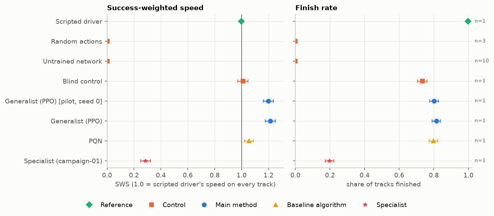

# Summary of all experiments

_Generated by `uv run python scripts/07_make_report.py` from the files in `results/` on 2026-11-14. Do not edit by hand; hand-written notes go in `reports/notes/`._

## Where things stand

21 of 116 runs (registered runs plus run-matrix entries) are evaluated. Status per phase:

| Phase | not started | planned | training | trained | evaluated | total |
|---|---|---|---|---|---|---|
| baselines | 0 | 0 | 0 | 0 | 15 | 15 |
| 1-first-models | 0 | 0 | 0 | 0 | 2 | 2 |
| 2-single-seed | 21 | 0 | 0 | 0 | 4 | 25 |
| 4-imitation-hybrids | 5 | 0 | 0 | 0 | 0 | 5 |
| 5-hyperparameters | 4 | 0 | 0 | 0 | 0 | 4 |
| 6-seed-sensitivity | 65 | 0 | 0 | 0 | 0 | 65 |
| **all** | 95 | 0 | 0 | 0 | 21 | 116 |

Statuses: **not started** = in the run matrix, not yet registered; **planned** = registered; code and config pushed before training; **training** = training in progress (or interrupted and resumable); **trained** = trained to its step budget, not yet evaluated; **evaluated** = evaluated; scores available.

## Headline results in plain words

- The Generalist (PPO) (1 seed) finished 81.5 % of the 971 unseen test tracks (95 % CI 79.0 % to 83.8 %), with a success-weighted speed (SWS) of 1.214 [1.177, 1.250]; an SWS of 1.0 would mean finishing every track as fast as the scripted driver.
- On the tracks it finished, it needed 0.67 times the scripted driver's time (32.7 % less time on average).
- Its finish rate was 8.1 percentage points more than the blind control (73.3 %, 1 seed); 1.6 percentage points more than the pqn (79.8 %, 1 seed); 81.5 percentage points more than the untrained network (0.0 %, 10 seeds); 81.5 percentage points more than the random actions (0.0 %, 3 seeds).
- The preregistered hypotheses H1-H3 are not tested yet: they need test results from 10 generalist seeds and 5 seeds each of the blind control and the single-track ablation (1 generalist seeds so far).
- On campaign track campaign-01 the generalist (zero-shot) was 2.8 % slower than the specialist trained on that track.

## Hypotheses (preregistered)

|  | Hypothesis | Tested quantity | Seeds (have/required) | Estimate [95 % CI] | Test statistic | p (one-sided) | p (Holm) | Decision |
|---|---|---|---|---|---|---|---|---|
| H1 | The generalist drives unseen tracks better than the scripted driver | SWS > 1.0 | generalist 1/10 | 1.214 [1.177, 1.250] (preliminary) | — | — | — | **not yet tested** |
| H2 | Track diversity is what generalises (50,000 tracks vs 1 track) | SWS difference > 0.1 | generalist 1/10, size-1 0/5 | — | — | — | — | **not yet tested** |
| H3 | The agent uses the look-ahead (generalist vs blind control) | SWS difference > 0.1 | generalist 1/10, blind 1/5 | 0.204 [0.164, 0.245] (preliminary) | — | — | — | **not yet tested** |

Decision rule: refuted if the 95 % interval lies below the threshold; confirmed if the Holm-adjusted one-sided t-test p-value is below 0.05; otherwise inconclusive; not yet tested until all preregistered seeds have test results.

## Main evaluation table

| Configuration | Role | Seeds | Test SWS [95 % CI] | Test finished | Val SWS [95 % CI] | Val finished | Train SWS [95 % CI] | Train finished | Own train SWS [95 % CI] | Own train finished | OOR SWS [95 % CI] | OOR finished | Campaign SWS [95 % CI] | Campaign finished | Unfiltered SWS [95 % CI] | Unfiltered finished |
|---|---|---|---|---|---|---|---|---|---|---|---|---|---|---|---|---|
| CEM planner | Reference | 1 | — | — | — | — | — | — | — | — | — | — | 1.551 [1.409, 1.726] | 100.0 % | — | — |
| Scripted driver | Reference | 1 | 0.998 [0.995, 1.000] | 99.8 % | 1.000 [1.000, 1.000] | 100.0 % | 0.999 [0.997, 1.000] | 99.9 % | — | — | 1.000 [1.000, 1.000] | 100.0 % | 1.000 [1.000, 1.000] | 100.0 % | 1.000 [1.000, 1.000] | 100.0 % |
| Random actions | Control | 3 | 0.000 [0.000, 0.000] | 0.0 % | 0.000 [0.000, 0.000] | 0.0 % | 0.000 [0.000, 0.000] | 0.0 % | — | — | 0.000 [0.000, 0.000] | 0.0 % | 0.000 [0.000, 0.000] | 0.0 % | 0.000 [0.000, 0.000] | 0.0 % |
| Untrained network | Control | 10 | 0.000 [0.000, 0.000] | 0.0 % | 0.000 [0.000, 0.000] | 0.0 % | 0.000 [0.000, 0.000] | 0.0 % | — | — | 0.000 [0.000, 0.000] | 0.0 % | 0.000 [0.000, 0.000] | 0.0 % | 0.000 [0.000, 0.000] | 0.0 % |
| Blind control | Control | 1 | 1.010 [0.971, 1.048] | 73.3 % | 1.003 [0.913, 1.086] | 72.6 % | 1.008 [0.970, 1.046] | 73.2 % | 1.008 [0.970, 1.046] | 73.2 % | 0.605 [0.506, 0.703] | 43.9 % | 1.443 [1.321, 1.590] | 100.0 % | 1.022 [0.934, 1.109] | 73.5 % |
| Generalist (PPO) [pilot, seed 0] | Main method | 1 | 1.199 [1.160, 1.237] | 80.2 % | 1.242 [1.159, 1.319] | 82.7 % | 1.234 [1.198, 1.269] | 82.6 % | — | — | 0.788 [0.678, 0.899] | 52.4 % | 1.596 [1.447, 1.799] | 100.0 % | 1.227 [1.143, 1.306] | 81.5 % |
| Generalist (PPO) | Main method | 1 | 1.214 [1.177, 1.250] | 81.5 % | 1.236 [1.153, 1.315] | 82.7 % | 1.250 [1.214, 1.283] | 83.9 % | 1.250 [1.214, 1.283] | 83.9 % | 0.875 [0.769, 0.982] | 57.8 % | 1.590 [1.451, 1.783] | 100.0 % | 1.231 [1.147, 1.311] | 82.0 % |
| PQN | Baseline algorithm | 1 | 1.054 [1.020, 1.086] | 79.8 % | 1.034 [0.956, 1.109] | 78.2 % | 1.052 [1.019, 1.085] | 79.7 % | 1.052 [1.019, 1.085] | 79.7 % | 0.725 [0.631, 0.820] | 55.1 % | 1.391 [1.270, 1.517] | 100.0 % | 1.105 [1.035, 1.173] | 83.0 % |
| Specialist (campaign-01) [pilot, seed 0] | Specialist | 1 | — | — | 0.188 [0.123, 0.260] | 13.2 % | — | — | — | — | — | — | 0.306 [0.000, 0.918] | 20.0 % | — | — |
| Specialist (campaign-01) | Specialist | 1 | 0.286 [0.250, 0.323] | 19.8 % | — | — | — | — | — | — | — | — | 0.577 [0.000, 1.188] | 40.0 % | — | — |

Track counts: Test (unseen generated): 971 tracks; Validation: 197 tracks; Training sample: 1,000 tracks; Own training tracks: 1,000 tracks; Out-of-range test: 187 tracks; Campaign (hand-made): 5 tracks; Unfiltered test: 200 tracks.

*SWS and finish rate on the test set (971 tracks), mean over seeds with 95 % two-level bootstrap intervals (10,000 resamples of seeds and tracks); n = number of seeds. With one seed the interval reflects track sampling only.*

## All networks and runs

| Configuration | Role | Algorithm | Architecture | Objective | Observation | Training data | Start states | Seeds with results | Status (runs) | SWS / finish rate per set |
|---|---|---|---|---|---|---|---|---|---|---|
| CEM planner | Reference | CEM | none (planner in the simulator) | none (not trained) | car state + look-ahead points (default) | none | - | 0 | 1 evaluated | Campaign 1.551 / 100 %; test25 1.322 / 92 % |
| Scripted driver | Reference | SCRIPTED | pure pursuit + curvature speed profile (no network) | none (not trained) | car state + look-ahead points (default) | none | - | 0 | 1 evaluated | Test 0.998 / 100 %; Val 1.000 / 100 %; Train 0.999 / 100 %; OOR 1.000 / 100 %; Campaign 1.000 / 100 %; Unfiltered 1.000 / 100 % |
| Random actions | Control | RANDOM | none (uniform random actions) | none (not trained) | car state + look-ahead points (default) | none | - | 0, 1, 2 | 3 evaluated | Test 0.000 / 0 %; Val 0.000 / 0 %; Train 0.000 / 0 %; OOR 0.000 / 0 %; Campaign 0.000 / 0 %; Unfiltered 0.000 / 0 % |
| Untrained network | Control | UNTRAINED | MLP 2x256 tanh (actor and critic), two 3-way heads | none (not trained) | car state + look-ahead points (default) | none | - | 0, 1, 2, 3, 4, 5, 6, 7, 8, 9 | 10 evaluated | Test 0.000 / 0 %; Val 0.000 / 0 %; Train 0.000 / 0 %; OOR 0.000 / 0 %; Campaign 0.000 / 0 %; Unfiltered 0.000 / 0 % |
| Blind control | Control | PPO | MLP 2x256 tanh (actor and critic), two 3-way heads | centreline progress | car state + nearest centreline point only (blind) | 48,949 generated tracks | standing + random centreline (p=0.5) | 1 | 1 evaluated, 4 not started | Test 1.010 / 73 %; Val 1.003 / 73 %; Train 1.008 / 73 %; Own train 1.008 / 73 %; OOR 0.605 / 44 %; Campaign 1.443 / 100 %; Unfiltered 1.022 / 74 % |
| Generalist (PPO) [pilot, seed 0] | Main method | PPO | MLP 2x256 tanh (actor and critic), two 3-way heads | centreline progress | car state + 20 look-ahead points | 48,949 generated tracks | standing + random centreline (p=0.5) | 0 | 1 evaluated | Test 1.199 / 80 %; Val 1.242 / 83 %; Train 1.234 / 83 %; OOR 0.788 / 52 %; Campaign 1.596 / 100 %; Unfiltered 1.227 / 82 % |
| Generalist (PPO) | Main method | PPO | MLP 2x256 tanh (actor and critic), two 3-way heads | centreline progress | car state + 20 look-ahead points | 48,949 generated tracks | standing + random centreline (p=0.5) | 1 | 1 evaluated, 9 not started | Test 1.214 / 81 %; Val 1.236 / 83 %; Train 1.250 / 84 %; Own train 1.250 / 84 %; OOR 0.875 / 58 %; Campaign 1.590 / 100 %; Unfiltered 1.231 / 82 % |
| PQN | Baseline algorithm | PQN | Q-network 2x256, LayerNorm, one 9-way head | centreline progress | car state + 20 look-ahead points | 48,949 generated tracks | standing + random centreline (p=0.5) | 1 | 1 evaluated, 2 not started | Test 1.054 / 80 %; Val 1.034 / 78 %; Train 1.052 / 80 %; Own train 1.052 / 80 %; OOR 0.725 / 55 %; Campaign 1.391 / 100 %; Unfiltered 1.105 / 83 % |
| Trained on 1 track | Ablation | PPO | MLP 2x256 tanh (actor and critic), two 3-way heads | centreline progress | car state + look-ahead points (default) | 1 generated tracks | standing + random centreline | — | 5 not started | — |
| Trained on 10 tracks | Ablation | PPO | MLP 2x256 tanh (actor and critic), two 3-way heads | centreline progress | car state + look-ahead points (default) | 10 generated tracks | standing + random centreline | — | 3 not started | — |
| Trained on 100 tracks | Ablation | PPO | MLP 2x256 tanh (actor and critic), two 3-way heads | centreline progress | car state + look-ahead points (default) | 100 generated tracks | standing + random centreline | — | 3 not started | — |
| Trained on 1,000 tracks | Ablation | PPO | MLP 2x256 tanh (actor and critic), two 3-way heads | centreline progress | car state + look-ahead points (default) | 1,000 generated tracks | standing + random centreline | — | 3 not started | — |
| Trained on 10,000 tracks | Ablation | PPO | MLP 2x256 tanh (actor and critic), two 3-way heads | centreline progress | car state + look-ahead points (default) | 10,000 generated tracks | standing + random centreline | — | 3 not started | — |
| Ablation: continuous actions | Ablation | PPO | MLP 2x256 tanh (actor and critic), Gaussian (steer, pedal) | centreline progress | car state + look-ahead points (default) | generated training pool | standing + random centreline | — | 3 not started | — |
| Ablation: 5 look-ahead points | Ablation | PPO | MLP 2x256 tanh (actor and critic), two 3-way heads | centreline progress | car state + 5 look-ahead points | generated training pool | standing + random centreline | — | 3 not started | — |
| Ablation: 40 look-ahead points | Ablation | PPO | MLP 2x256 tanh (actor and critic), two 3-way heads | centreline progress | car state + 40 look-ahead points | generated training pool | standing + random centreline | — | 3 not started | — |
| Ablation: time cost | Ablation | PPO | MLP 2x256 tanh (actor and critic), two 3-way heads | centreline progress - time cost 0.06/step | car state + look-ahead points (default) | generated training pool | standing + random centreline | — | 3 not started | — |
| Ablation: 10 Hz actions | Ablation | PPO | MLP 2x256 tanh (actor and critic), two 3-way heads | centreline progress | car state + look-ahead points (default) | generated training pool | standing + random centreline | — | 3 not started | — |
| Ablation: fall penalty | Ablation | PPO | MLP 2x256 tanh (actor and critic), two 3-way heads | centreline progress - penalty 5.0 when out | car state + look-ahead points (default) | generated training pool | standing + random centreline | — | 3 not started | — |
| Ablation: one 9-way head | Ablation | PPO | MLP 2x256 tanh (actor and critic), one 9-way head | centreline progress | car state + look-ahead points (default) | generated training pool | standing + random centreline | — | 3 not started | — |
| Behaviour cloning | Imitation / hybrid | IMITATION-BC | MLP 2x256 tanh (actor and critic), two 3-way heads | copy the scripted driver's actions (cross-entropy) | car state + look-ahead points (default) | generated training pool | standing + random centreline | — | 1 not started | — |
| DAgger | Imitation / hybrid | IMITATION-DAGGER | MLP 2x256 tanh (actor and critic), two 3-way heads | copy the scripted driver's actions (cross-entropy) | car state + look-ahead points (default) | generated training pool | standing + random centreline | — | 1 not started | — |
| BC then PPO | Imitation / hybrid | PPO | MLP 2x256 tanh (actor and critic), two 3-way heads | centreline progress | car state + look-ahead points (default) | generated training pool | standing + random centreline | — | 1 not started | — |
| PPO + reward hints | Imitation / hybrid | PPO | MLP 2x256 tanh (actor and critic), two 3-way heads | centreline progress + scripted-driver hint x0.05 | car state + look-ahead points (default) | generated training pool | standing + random centreline | — | 1 not started | — |
| PPO + scripted start states | Imitation / hybrid | PPO | MLP 2x256 tanh (actor and critic), two 3-way heads | centreline progress | car state + look-ahead points (default) | generated training pool | standing + scripted-driver states | — | 1 not started | — |
| HP: learning rate / 3 | Hyperparameter | PPO | MLP 2x256 tanh (actor and critic), two 3-way heads | centreline progress | car state + look-ahead points (default) | generated training pool | standing + random centreline | — | 2 not started | — |
| HP: discount 0.995 | Hyperparameter | PPO | MLP 2x256 tanh (actor and critic), two 3-way heads | centreline progress | car state + look-ahead points (default) | generated training pool | standing + random centreline | — | 2 not started | — |
| HP: 3x512 networks | Hyperparameter | PPO | MLP 3x512 tanh (actor and critic), two 3-way heads | centreline progress | car state + look-ahead points (default) | generated training pool | standing + random centreline | — | 2 not started | — |
| HP: weight decay 1e-5 | Hyperparameter | PPO | MLP 2x256 tanh (actor and critic), two 3-way heads | centreline progress | car state + look-ahead points (default) | generated training pool | standing + random centreline | — | 2 not started | — |
| Specialist (campaign-01) [pilot, seed 0] | Specialist | PPO | MLP 2x256 tanh (actor and critic), two 3-way heads | centreline progress | car state + 20 look-ahead points | one campaign track (campaign-01) | standing + random centreline (p=0.5) | 0 | 1 evaluated | Val 0.188 / 13 %; Campaign 0.306 / 20 % |
| Specialist (campaign-01) | Specialist | PPO | MLP 2x256 tanh (actor and critic), two 3-way heads | centreline progress | car state + 20 look-ahead points | one campaign track (campaign-01) | standing + random centreline (p=0.5) | 1 | 1 evaluated, 4 not started | Test 0.286 / 20 %; Campaign 0.577 / 40 % |
| Specialist (campaign-02) | Specialist | PPO | MLP 2x256 tanh (actor and critic), two 3-way heads | centreline progress | car state + look-ahead points (default) | one campaign track (campaign-02) | standing + random centreline | — | 5 not started | — |
| Specialist (campaign-03) | Specialist | PPO | MLP 2x256 tanh (actor and critic), two 3-way heads | centreline progress | car state + look-ahead points (default) | one campaign track (campaign-03) | standing + random centreline | — | 5 not started | — |
| Specialist (campaign-04) | Specialist | PPO | MLP 2x256 tanh (actor and critic), two 3-way heads | centreline progress | car state + look-ahead points (default) | one campaign track (campaign-04) | standing + random centreline | — | 5 not started | — |
| Specialist (campaign-05) | Specialist | PPO | MLP 2x256 tanh (actor and critic), two 3-way heads | centreline progress | car state + look-ahead points (default) | one campaign track (campaign-05) | standing + random centreline | — | 5 not started | — |
| Fine-tuned specialist (campaign-01) | Specialist | PPO | MLP 2x256 tanh (actor and critic), two 3-way heads | centreline progress | car state + look-ahead points (default) | one campaign track (campaign-01) | standing + random centreline | — | 1 not started | — |
| Fine-tuned specialist (campaign-02) | Specialist | PPO | MLP 2x256 tanh (actor and critic), two 3-way heads | centreline progress | car state + look-ahead points (default) | one campaign track (campaign-02) | standing + random centreline | — | 1 not started | — |
| Fine-tuned specialist (campaign-03) | Specialist | PPO | MLP 2x256 tanh (actor and critic), two 3-way heads | centreline progress | car state + look-ahead points (default) | one campaign track (campaign-03) | standing + random centreline | — | 1 not started | — |
| Fine-tuned specialist (campaign-04) | Specialist | PPO | MLP 2x256 tanh (actor and critic), two 3-way heads | centreline progress | car state + look-ahead points (default) | one campaign track (campaign-04) | standing + random centreline | — | 1 not started | — |
| Fine-tuned specialist (campaign-05) | Specialist | PPO | MLP 2x256 tanh (actor and critic), two 3-way heads | centreline progress | car state + look-ahead points (default) | one campaign track (campaign-05) | standing + random centreline | — | 1 not started | — |

## Experiment reports

| Report | Question | Runs |
|---|---|---|
| [First models (phase 1)](experiments/first-models.md) | Does the pipeline learn one track (specialist) and many tracks (generalist pilot)? | 2 evaluated |
| [Training-free baselines and controls](experiments/baselines.md) | Floor (random actions, untrained network) and reference (scripted driver). | 15 evaluated |
| [Generalist](experiments/generalist.md) | Can one policy trained on the generated pool drive unseen tracks (H1)? | 1 evaluated, 9 not started |
| [Blind control](experiments/blind-control.md) | Does the agent use the look-ahead (H3)? | 1 evaluated, 4 not started |
| [Training-set size](experiments/training-set-size.md) | Is track diversity what generalises (H2)? | 17 not started |
| [Specialists](experiments/specialists.md) | How much time does a generalist lose against single-track specialists? | 1 evaluated, 29 not started |
| [Baseline algorithm: PQN](experiments/pqn.md) | Does the result depend on PPO? | 1 evaluated, 2 not started |
| [Ablations: inputs, actions and reward](experiments/ablations.md) | Which design choices matter (exploratory)? | 21 not started |
| [Imitation and hybrids (phase 4)](experiments/imitation-hybrids.md) | What does help from the scripted driver change (exploratory)? | 5 not started |
| [Hyperparameter sensitivity (phase 5)](experiments/hyperparameters.md) | How far does the test score move when one setting changes? | 8 not started |
| [Patched physics (phase 3)](experiments/patched-physics.md) | How much did an exploit contribute? | — |
| [Seed sensitivity (phase 6)](experiments/seed-sensitivity.md) | How much do results vary between seeds, and do the single-seed results hold? | — |

## Track sets

| Set | Seeds | Generated | Geometric rejects | Certification rejects | Kept | Mean length (m) | Mean reference time (s) |
|---|---|---|---|---|---|---|---|
| oor | 3,000,000 - 3,000,199 | 200 | 0 | 13 | 187 | 1335 | 66.0 |
| test | 2,000,000 - 2,000,999 | 1,000 | 0 | 29 | 971 | 1117 | 50.9 |
| test_unfiltered | 2,000,000 - 2,000,199 | 200 | 0 | 5 | 200 | 1102 | 50.6 |
| train | 0 - 49,999 | 50,000 | 0 | 1,051 | 48,949 | 1112 | 50.8 |
| val | 1,000,000 - 1,000,199 | 200 | 0 | 3 | 197 | 1130 | 51.5 |

### Reads of the protected test sets

| Protected set | Policy | Reads |
|---|---|---|
| oor | RandomDriver | 3 |
| oor | blind/seed1 | 1 |
| oor | export:unseen-track-demo | 1 |
| oor | generalist/seed0 | 2 |
| oor | generalist/seed1 | 1 |
| oor | pqn/seed1 | 1 |
| oor | scripted | 1 |
| oor | untrained-seed0 | 1 |
| oor | untrained-seed1 | 1 |
| oor | untrained-seed2 | 1 |
| oor | untrained-seed3 | 1 |
| oor | untrained-seed4 | 1 |
| oor | untrained-seed5 | 1 |
| oor | untrained-seed6 | 1 |
| oor | untrained-seed7 | 1 |
| oor | untrained-seed8 | 1 |
| oor | untrained-seed9 | 1 |
| test | RandomDriver | 3 |
| test | blind/seed1 | 1 |
| test | cem | 2 |
| test | export:unseen-track-demo | 4 |
| test | generalist/seed0 | 2 |
| test | generalist/seed1 | 1 |
| test | pqn/seed1 | 1 |
| test | scripted | 3 |
| test | specialist-campaign-01/seed1 | 1 |
| test | untrained-seed0 | 1 |
| test | untrained-seed1 | 1 |
| test | untrained-seed2 | 1 |
| test | untrained-seed3 | 1 |
| test | untrained-seed4 | 1 |
| test | untrained-seed5 | 1 |
| test | untrained-seed6 | 1 |
| test | untrained-seed7 | 1 |
| test | untrained-seed8 | 1 |
| test | untrained-seed9 | 1 |
| test_unfiltered | RandomDriver | 3 |
| test_unfiltered | blind/seed1 | 1 |
| test_unfiltered | generalist/seed0 | 1 |
| test_unfiltered | generalist/seed1 | 1 |
| test_unfiltered | pqn/seed1 | 1 |
| test_unfiltered | scripted | 1 |
| test_unfiltered | untrained-seed0 | 1 |
| test_unfiltered | untrained-seed1 | 1 |
| test_unfiltered | untrained-seed2 | 1 |
| test_unfiltered | untrained-seed3 | 1 |
| test_unfiltered | untrained-seed4 | 1 |
| test_unfiltered | untrained-seed5 | 1 |
| test_unfiltered | untrained-seed6 | 1 |
| test_unfiltered | untrained-seed7 | 1 |
| test_unfiltered | untrained-seed8 | 1 |
| test_unfiltered | untrained-seed9 | 1 |

## Simulator throughput

_No simulator benchmark recorded yet (`results/bench/`)._

## Physics exploits

_No exploit list yet (`results/exploits.json` does not exist)._

### Evaluator flags

| Configuration | Set | Overspeed flags | Coasting energy-gain flags | Seeds | Tracks |
|---|---|---|---|---|---|
| Untrained network | OOR | 0 | 1 | 10 | 187 |
| Blind control | Own train | 0 | 2 | 1 | 1000 |
| Blind control | Train | 0 | 2 | 1 | 1000 |
| Blind control | Val | 0 | 1 | 1 | 197 |
| Generalist (PPO) [pilot, seed 0] | Train | 0 | 3 | 1 | 1000 |
| Generalist (PPO) | OOR | 0 | 3 | 1 | 187 |
| Generalist (PPO) | Test | 0 | 1 | 1 | 971 |
| PQN | Test | 0 | 1 | 1 | 971 |
| PQN | Own train | 0 | 1 | 1 | 1000 |
| PQN | Train | 0 | 1 | 1 | 1000 |

## Key terms

| Term | Technical meaning | In plain words |
|---|---|---|
| Success-weighted speed (SWS) | Mean over tracks of finished x (reference time / agent time); 0 for an unfinished track. Adapted from SPL (Anderson et al. 2018). | 1.0 = finishes every track as fast as the scripted driver; above 1 = faster; 0 = finishes nothing. |
| Finish rate | Share of tracks finished within 3x the reference time without falling off or stalling. | How often the car gets to the end. |
| Scripted driver | Pure-pursuit steering with a curvature speed profile, 2 parameters tuned on validation tracks, then frozen. | A hand-written autopilot used as the yardstick. |
| Reference time | The scripted driver's finishing time on a track (it certifies that every kept track can be finished). | The time to beat. |
| Generalist | One PPO policy trained on the whole generated training pool. | One driver that has practised on many tracks. |
| Specialist | A policy trained on one campaign track only. | A driver that has practised one track. |
| Blind control | The generalist recipe without the upcoming-track points in the input. | The same driver, but it cannot see the road ahead. |
| Training-set size ablation | The generalist recipe trained on only N tracks (1 to 10,000). | Does practising on more different tracks help on new ones? |
| PPO / PQN | Proximal Policy Optimization (Schulman et al. 2017) / Parallelised Q-Network (Gallici et al. 2025). | Two ways to learn from trial and error. |
| Seed | One independent training run with its own random initialisation and data order. | Repeating the experiment to see how much luck matters. |
| Test / validation / out-of-range / campaign | Disjoint track sets: test (never used for decisions), validation (development decisions), out-of-range (one generator factor beyond training), campaign (5 hand-made). | Exams with tracks the driver never practised on. |
| Train-test gap | Score on the run's own training tracks minus score on test tracks (Kirk et al. 2023). | How much better it drives tracks it practised on. |
| 95 % CI (two-level bootstrap) | Percentile interval from 10,000 resamples of seeds and tracks (Owen 2007). | The range the true score plausibly lies in. |
| Holm correction | Step-down adjustment of p-values for testing three hypotheses (Holm 1979). | Guards against lucky findings when testing several things. |
| Welch's t-test | t-test without assuming equal variances, on per-seed scores (Colas et al. 2019). | Is the difference between two groups of runs bigger than chance? |
| IQM, probability of improvement | Interquartile mean; share of run pairs where one agent beats the other, averaged over tracks (Agarwal et al. 2021). | Robust averages and head-to-head win rates. |
| Exploit flag | Evaluator detector: speed above 1.2x top speed, or energy gained while coasting. | A hint that the agent found a bug in the physics. |
| Physics version | Tag of the simulator; v1 is the unmodified cannon-es port; patched versions fix exploits. | Which rules of the game world were used. |
| Agent step | One decision of the agent: 5 physics ticks of 0.01 s. | One keyboard input held for 0.05 s. |

## Data integrity

117 evaluation files read; 0 per-track scores disagree with finished x reference ticks / ticks (they are reported as written by the evaluator).
